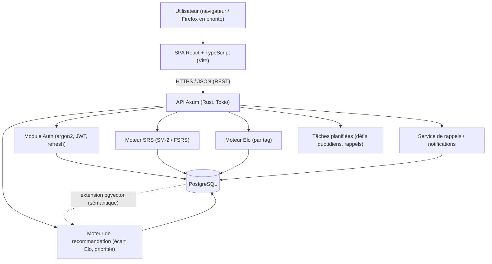
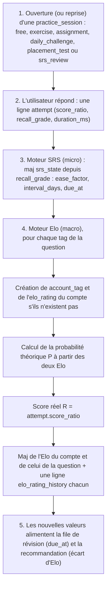

# Cahier des Charges — Plateforme d'Apprentissage par Répétition Espacée

**Version :** 3.1 — architecture et navigation déléguées à leurs documents dédiés (`ARCHITECTURE.md`, `NAVIGATION.md`) ; 3.0 : décisions V1 actées (stack Rust + React/TypeScript, monolithe en 3 serveurs, tests et CI/CD dès le premier jour).
**Projet :** Système Informatique de Gestion de Révisions Espacées (SIGRE)
**Fichier :** `ABOUT_PROJECT.md` (ce document remplace `SPECIFICATIONS.md`)
**Statut :** brouillon de travail

---

## 0. Synthèse (QUOI / POURQUOI / COMMENT)

Créer une plateforme d'apprentissage web **gratuite, open-source et communautaire**, combinant des mécanismes scientifiques d'optimisation de la mémoire (répétition espacée SM-2/FSRS, courbe de l'oubli, principe de Pareto) avec un système de classement de niveau (Elo), pour offrir un suivi pédagogique ultra-personnalisé.

**Pourquoi Rust + React/TypeScript ?**

- **Signal fort pour un portfolio** : Rust démontre la maîtrise du typage strict, de la gestion mémoire et de l'architecture logicielle — un profil qui se démarque immédiatement des profils JavaScript « purs ».
- **Stack moderne et cohérente** : Rust (Axum + SQLx) au backend, React + TypeScript au frontend est une architecture propre, performante et appréciée des équipes exigeantes.
- **Performance et sobriété** : Rust consomme très peu de CPU/RAM — cohérent avec l'objectif d'éco-conception et d'hébergement souverain à coût maîtrisé.
- **Fiabilité** : le compilateur Rust garantit l'absence de data races et d'erreurs mémoire — la plateforme gère des données sensibles (mineurs, scolarité), c'est un argument de sécurité fort.
- **Rôle de l'IA** : l'IA (Claude, Cursor, Copilot) gère bien la syntaxe verbeuse de Rust et le code répétitif de React ; elle débloque vite sur le borrow checker. Un MVP réaliste en **3 à 5 semaines à temps partiel** (10–15 h/semaine).

**Enjeux sociétaux :**

1. **Renforcer l'intelligence humaine face à l'IA** : valoriser ce que l'humain a de plus précieux — esprit critique, mémoire, capacité d'apprendre et de transmettre.
2. **Combattre l'obscurantisme et le déclin du niveau scolaire** : recul en mathématiques, mauvais classements PISA, inégalités selon le milieu social, sur-stimulation qui dégrade concentration et mémorisation.
3. **Réduire les inégalités éducatives** : un outil **égalitaire** (accessible à tous) et **équitable** (personnalisé selon les besoins) qui « nivele vers le haut ».
4. **Libérer du temps aux enseignants** : l'application prend en charge la répétition des savoirs fondamentaux (20 % d'effort pour 80 % de résultat), le professeur garde le rôle irremplaçable : expliquer comment raisonner, débattre, créer, analyser.

> « Mieux vaut une tête bien faite qu'une tête bien pleine. » — Montaigne. Une tête bien faite **et** bien pleine, c'est mieux encore.
> « C'est en forgeant que l'on devient forgeron. »

**Vision longue durée :** plateforme communautaire de création/partage/validation de savoirs → outil de certification de compétences → base d'évaluation nationale continue → compagnon de vie éducatif.

---

## 1. Présentation Générale

### 1.1 Utilisateurs cibles (QUI ?)

| Profil | Besoin principal |
|---|---|
| **Élèves** (primaire → lycée → études sup.) | Réviser efficacement, renforcer les bases, progresser à leur rythme |
| **Enseignants** | Suivre la progression de la classe, créer des exercices, proposer devoirs interactifs ou imprimables |
| **Apprentis / adultes en reconversion** | Auto-formation structurée |
| **Particuliers** | Apprendre et réviser librement (code de la route, code du travail, vivre seul, santé…) |

### 1.2 Cas d'utilisation (Use cases)

1. **Classe** : le professeur crée un groupe et invite ses élèves.
2. **Non-contrainte** : l'application ne doit pas imposer une méthode pédagogique ; elle propose une alternative ou un complément, avec le minimum de freins à l'usage.
3. **Contribution communautaire** : professeurs et élèves proposent des exercices ; validation par la communauté (cycle `private` → `pending_review` → `published` / `rejected`). Vigilance : dérives (contenus politisés, droit d'auteur, contenus sensibles), doublons.
4. **Exercices locaux** : le prof peut créer ses exercices en local (privés), sans les publier.
5. **Double notation du niveau** :
   - niveau initial défini par le créateur, affiné par les contributeurs ;
   - second indicateur **auto-calibré par les résultats** (ex. : un exercice raté par des 3ᵉ en milieu d'année mais réussi par des 2ᵈᵉ en fin d'année → niveau recalé « début/milieu de seconde »). Le moteur Elo réalise ce calibrage naturellement.
6. **Devoirs / contrôles** : le prof sélectionne une suite d'exercices (par niveau cible et sujet, ex. « terminale — nombres imaginaires ») et la propose en devoirs ou en **contrôle imprimable** ; le contrôle papier peut être scanné et corrigé automatiquement ou manuellement.
7. **Periods de travail** : le chef de groupe affecte une liste d'exercices sur une période donnée.
8. **Suivi anti-triche** : le chef de groupe consulte les réponses des devoirs **avec le temps passé** sur chaque exercice.
9. **Test de niveau initial** : dans un thème/tag, l'application génère aléatoirement des exercices de niveaux variés pour situer l'utilisateur (placement type Elo).
10. **Défi quotidien** : l'application propose chaque jour des exercices couvrant les connaissances qui « datent » (révision) et celles en cours d'apprentissage — SRS **macro** (savoir-faire : ex. théorème de Pythagore) et SRS **micro** (savoirs par cœur : formules, vocabulaire).
11. **Personnalisation avancée** : en cas d'usage régulier, renouvellement personnalisé des exercices selon les résultats des précédents contrôles (courbe d'oubli + apprentissage).
12. **Reprise après interruption** : si l'application n'a pas été utilisée depuis longtemps, le professeur peut **ignorer les recommandations obsolètes** et re-sélectionner manuellement une suite d'exercices (comme à l'initialisation).
13. **Accessibilité « jeu vidéo »** : simplicité d'usage comparable à un jeu, défis quotidiens, succès déblocables — pour ancrer l'habitude de revenir régulièrement.

### 1.3 Fonctionnalités transverses (notes de cadrage)

- **Système de rappel / notification** : rappels configurables (e-mail, push web), respectueux (pas de spam, horaires paramétrables, désactivation en un clic) — conforme RGPD.
- **Défi quotidien** : une série courte proposée chaque jour, déblocant succès/flamme (streak).
- **Matrice de priorité** : classement des révisions à faire (urgence SRS × écart Elo × importance du tag) affichée à l'utilisateur.
- **Tutoriel intégré** : parcours de prise en main guidé (réalisation d'exercices de tutoriel) à la première connexion.
- **Suivi de projet** : les issues du dépôt Git du projet portent une **date cible** (milestone).
- **Objectifs pédagogiques** : l'objectif de réussite est une **barre minimale (ex. 17/20)** et non la moyenne de la groupe ; **jamais de comparaison avec la moyenne du groupe** (équité, pas de nivellement). Chaque objectif peut porter une **limite de temps**.
- **Reporting & gamification** : tableaux de bord de progression, badges, rangs, défis.

### 1.4 Types d'exercices (COMMENT ?)

Types de questions implémentés dans le schéma (`question.question_type`) :

- **Flashcard** (`flashcard`) — auto-évaluée (`recall_grade`)
- **Vrai/Faux** (`true_false`)
- **QCU** (`single_choice`) / **QCM** (`multiple_choice`) — réponse unique ou multiple, avec distracteurs
- **Réponse courte** (`short_answer`) / **réponses multiples saisies** (`multi_answer`)
- **Texte à trous** (`fill_in_blank`)
- **Classement / remise en ordre** (`ordering`)
- **Repérage d'erreurs** (`error_spotting`) / **repérage de passage** (`span_selection`)
- **Question ouverte** (`open_ended`) — corrigée par soi-même ou par un tiers

Extensions prévues par le cahier des charges, pas encore dans le schéma : **dictée**, **reconnaissance vocale / sonore**, exercices de **concentration** (flow), exercices de **rapidité** (timer, déjà mesuré par `attempt.duration_ms`), exercices de mémorisation.

### 1.5 Thèmes (QUOI ?)

L'arborescence complète des tags (table `tag`, avec contexte national `country_code` : « Histoire > Sport » ≠ « Sport » racine) sera maintenue dans un fichier dédié (TODO du modèle métier). Aperçu :

- **Formation scolaire** : langues vivantes (vocabulaire, grammaire, orthographe, conjugaison), mathématiques (calcul, arithmétique, algèbre, géométrie, probabilités), sciences (physique, chimie, biologie), histoire-géo, informatique.
- **Citoyenneté, droit et vie quotidienne** : code de la route, code du travail, base juridique (constitution, contrat, impôts), vivre seul (logement, budget, mutuelle, assurance), textes juridiques → « bon citoyen ». Option : citation/maximes, art.
- **Santé** : hygiène, suivi de rendez-vous médicaux, sommeil, secourisme, sensibilisation ; nutrition et cuisine ; activité physique (étirements, échauffement, théorie, programmes de reprise/maintien/performance).
- **Divertissement / loisir** : musique, dessin, montage vidéo, magie/mentalisme, jardinage, bricolage…
- **Conseil de programmation** (pour le public développeur).

**Limites et précautions :**
- Thèmes interdits : **pas de politique, pas de religion**.
- Charte qualité : lutte contre les fake news, vérification des contenus, respect de la diversité culturelle.
- Public jeune : vigilance renforcée (contenus, sécurité, valeurs transmises), conformité RGPD mineurs.

### 1.6 Mécanismes possibles

| Mécanisme | Références | Effet |
|---|---|---|
| Répétition espacée (SRS) | SM-2 (Anki), FSRS, SM-18/19 (SuperMemo) | Courbe de l'oubli → **quand** revoir |
| Classement de niveau | Elo, Glicko/TrueSkill | Rang, XP, niveau → **quel niveau** |
| Classification | Tags, sous-tags, thèmes | Taxonomie des compétences → **quoi** |
| Rappel / habitude | Défi quotidien, chaînes (streak/flamme) | Création d'habitude, casse la monotonie |
| Récompense | Badges, succès, rangs, parcours déblocables | Circuit de récompense (dopamine), challenge |
| Appartenance | Amis, groupes, rôles, droits ; chat intégré / forum / commentaires / feedback | Fonctions communautaires et sociales |
| Personnalisation | Profils, préférences | Implication de l'utilisateur |
| Compétition saine | Défis de groupe (sans classement humiliant, sans comparaison à la moyenne) | Engagement dans le temps |

Référence technique SRS : [juliensobczak.com — Anki SRS](https://juliensobczak.com/inspect/2022/05/30/anki-srs/)

### 1.7 Inspirations et sources de contenu

**Applications existantes à étudier (benchmark d'usage, pas de copie) :**

| Application | Ce qu'on en retient |
|---|---|
| **Loop Habit Tracker** (et équivalents) | Mécanique d'habitude : streak/flamme, rappels doux, visualisation de la chaîne de jours — à transposer au défi quotidien |
| **Taskboard / tableaux Kanban** (Taskboard, tableaux type Google) | Gestion visuelle des tâches : transposer en tableau de révisions (à faire / en cours / maîtrisé) et en matrice de priorité |
| **Anki / SuperMemo** | Référence SRS (SM-2, FSRS) : file de cartes, notation de la difficulté |

**Sources de contenu libres (BDD « super légère », réutilisation et adaptation) :**

- **wikiHow** : tutoriels pratiques de la vie quotidienne (vivre seul, bricolage, cuisine, santé).
- **Wikilivres / Wikiversité** : cours structurés réutilisables (scolaire, informatique).
- **Wikipédia** : base de connaissances légère pour les thèmes histoire — histoire du pays, histoire du continent, géopolitique (dates clés, repères).
- Contrainte : respect des licences (CC BY-SA), attribution systématique, pas de copie brute sans adaptation pédagogique.

---

## 2. Présentation Technique

### 2.1 Doctrine qualité (critères du projet)

Chaque choix technique sera évalué contre ces critères :

| Critère | Exigence |
|---|---|
| **Libéré** | Stack 100 % libre et open-source, souveraine (pas de dépendance à une juridiction extra-française pour les données) |
| **Testé** | Code testé automatiquement (unitaires, intégration, E2E) |
| **Normé** | Normes de codage respectées (rustfmt/clippy, ESLint/Prettier) + conformité normes FR/UE (RGPD, accessibilité) |
| **Documenté** | Code documenté (rustdoc, TSDoc), diagrammes UML, ADR (architecture decision records) |
| **Éprouvé** | Langage et bibliothèques matures, utilisés en production depuis longtemps |
| **Maturé** | Livraison « finie et complète » par incréments, pas de MVP abandonné |
| **Sécurisé** | Simplicité d'attaque réduite, mots de passe forts, API durcie, RGPD/CNIL, viser les référentiels (SecNumCloud comme horizon) |
| **Maîtrisé** | Maîtrise verticale de la stack : matériel, logiciel, données — auto-hébergement possible |
| **Distribué** | Scalabilité horizontale (stateless, conteneurs) |
| **Optimisé** | Cible Debian (Linux) côté serveur, Firefox (Gecko) côté client en priorité |
| **Compatible** | Web universel : la compilation et l'exécution doivent marcher partout (C/C++/Python/HTML/CSS/JS-TS dans l'écosystème si besoin) |

**Ouvertures techniques (à étudier, non bloquant pour le MVP) :** protocole QUIC, sérialisation Protobuf (avec JSON pour l'API publique), trames IPv6, WebAssembly (partage de logique métier Rust entre backend et frontend), architecture n-tiers, base de données **sémantique** en complément du relationnel (embeddings vectoriels pour la recherche de contenus similaires et la détection de doublons).

**Sécurité — DICT :**
- **D**isponibilité : redondance, sauvegardes, mode dégradé.
- **I**ntégrité : validations strictes des entrées, migrations versionnées, journal des modifications.
- **C**onfidentialité : chiffrement TLS, hachage des secrets, cloisonnement des rôles.
- **T**raçabilité : journal d'audit des actions sensibles (connexions, modifications de contenus, exports).

### 2.2 Stack Technique

**Backend — Rust**

| Composant | Choix | Rôle |
|---|---|---|
| Framework web | **Axum** (sur **Tokio**) | API REST async, typée, ergonomique |
| Base de données | **SQLx** (PostgreSQL) | Requêtes SQL vérifiées à la compilation, migrations intégrées |
| Authentification | **jsonwebtoken** + sessions/refresh tokens | JWT signés, rotation des refresh tokens |
| Hachage mots de passe | **argon2** (variante Argon2id, sel + poivre) | Standard actuel, plus robuste que BCrypt |
| Validation | **validator** / types newtype | Validation des entrées côté serveur |
| Sérialisation | **serde** / **serde_json** | JSON typé de bout en bout |
| Observabilité | **tracing** + OpenTelemetry | Logs structurés, métriques |
| Tests | **cargo test**, **reqwest** + testcontainers | Unitaires, intégration, conteneurs éphémères |

**Frontend — React + TypeScript**

| Composant | Choix | Rôle |
|---|---|---|
| Bundler/dev server | **Vite** | Build rapide, HMR |
| UI | **React 18+** + **TypeScript strict** | SPA réactive, typage fort |
| Composants | **shadcn/ui** (Tailwind) ou MUI | Accessibilité intégrée, cohérence visuelle |
| État serveur | **TanStack Query** | Cache, revalidation, appels réseau limités |
| Graphiques | **Recharts** ou visx | Progression, courbes d'oubli |
| Formulaires | **react-hook-form** + **zod** | Validation partagée avec le backend (schémas) |
| Tests | **Vitest** + **React Testing Library** + **Playwright** | Unitaires, composants, E2E |

**Données & infrastructure**

| Composant | Choix | Rôle |
|---|---|---|
| BDD principale | **PostgreSQL 16** (15 min., requis pour `UNIQUE NULLS NOT DISTINCT`) | Cœur relationnel : comptes, groupes, contenu, SRS, Elo (schéma `app`) |
| BDD sémantique (option) | **pgvector** (extension PostgreSQL) | Embeddings : recherche de contenus proches, détection de doublons, recommandation |
| Conteneurisation | **Docker** (+ Compose en dev, Debian slim en prod) | Reproductibilité, déploiement |
| Hébergement | VPS souverain (préféré) ou Railway/Fly.io (phase de test) | Maîtrise verticale vs rapidité de mise en ligne |
| CI/CD | GitHub Actions (auto-hébergé plus tard) | Tests, lint, build, déploiement |

**Environnement de développement (V1) :** développement **sous Windows** (éditeur au choix) avec Docker Desktop (WSL2) pour PostgreSQL ; les conteneurs de production sont Linux (Debian). Un `.gitattributes` garantit les LF pour que le code s'exécute à l'identique sur les deux plateformes (critère *Compatibilité* de § 2.1).

**Déploiement (V1) :** un **monolithe** déployé sur **3 serveurs** — front (statique servi par nginx), back (API Axum), bdd (PostgreSQL) — orchestrés par Docker Compose sur un même hôte. Un worker Rust (défis quotidiens, rappels) s'ajoutera plus tard comme service du même compose, sans changer le modèle. Voir § 2.3.

> **Note MongoDB** : le besoin « NoSQL » du cahier initial (contenus flexibles, sémantique) est couvert par PostgreSQL en **JSONB** + **pgvector**, ce qui évite une seconde base à opérer — cohérent avec les critères *Maîtrisé* et *Simplifié*.

> **Modèle métier** : la source de vérité technique est la migration **`V0001__initial_schema.sql`** (schéma `app`), expliquée par **`DOMAIN_MODEL.md`** (le *pourquoi*). Toute évolution modifie les deux, dans le même commit.

### 2.3 Architecture Technique

Architecture **n-tiers** modulaire (monolithe modulaire d'abord, découpage en services seulement quand la charge l'exige — voir critère *Distribué*) :

- Le frontend est servi en statique, l'API est **stateless** → scalabilité horizontale. **Monolithe en 3 serveurs (V1)** : `front` (nginx + build Vite), `back` (API Axum), `bdd` (PostgreSQL), reliés par un réseau Docker privé ; un seul `docker compose up` démarre tout. Le worker (défis quotidiens, rappels) sera un 4ᵉ service du même compose.

> **Diviser pour mieux régner :** ce paragraphe ne donne que la vue d'ensemble. Le détail complet — organisation du dépôt, crates et couches, flux d'une réponse, tests, Docker, CI/CD, décisions — vit dans **`ARCHITECTURE.md`**.

### 2.10 Tests et CI/CD (dès le premier jour)

**Principe V1 : la pipeline doit être verte avant d'écrire la première ligne de logique métier.** Chaque commit passe par elle ; rien ne part en production si elle échoue.

**Pyramide de tests :**
- **Unitaires** : les moteurs SM-2 et Elo, cœur du projet (§ 3.1), testés exhaustivement (bornes, monotonie, historique) ;
- **Intégration** : l'API contre un PostgreSQL éphémère (testcontainers), y compris les contraintes de `V0001` ;
- **E2E** : Playwright sur les parcours critiques (inscription, session de révision, devoir).

**Pipeline CI (GitHub Actions, un workflow par tier) :**

| Étape | Back (Rust) | Front (React/TS) |
|---|---|---|
| Mise en forme | `cargo fmt --check` | Prettier `--check` |
| Lint | `cargo clippy --all-targets -- -D warnings` | ESLint |
| Requêtes SQL vérifiées | `cargo sqlx prepare --check` (mode hors ligne, pas de base en CI) | — |
| Tests | `cargo test` (+ conteneur PostgreSQL pour l'intégration) | Vitest |
| Build | `cargo build --release` | `vite build` |
| Image | `docker build` | idem |

**CD :** merge sur `main` = build des images + déploiement (compose) sur le VPS. `main` est ce qui tourne en production (`GIT_WORKFLOW.md`). Les conventions de code qui rendent tout cela vérifiable sont dans `STYLE_RUST.md`, `STYLE_REACT.md`, `STYLE_API.md` et `STYLE_SQL.md`.

### 2.4 Modèle Métier

> **Diviser pour mieux régner :** le modèle métier vit dans son propre document. Ce paragraphe ne donne que la vue fonctionnelle nécessaire au cahier des charges ; le détail (tables, colonnes, contraintes, décisions justifiées) est dans **`DOMAIN_MODEL.md`**, dont la source de vérité technique est **`V0001__initial_schema.sql`**. Toute évolution modifie les deux dans le même commit.

**Vue fonctionnelle :** la base stocke l'état et garantit sa cohérence (contraintes `CHECK`, arcs exclusifs, index partiels, déclencheur `updated_at`) ; les calculs (SM-2, Elo) se font dans l'application. Sept domaines : référentiels, comptes & social, contenu pédagogique, tags, devoirs & pratique, apprentissage adaptatif (SRS & Elo), avis & modération.

**Les trois couches, orthogonales, mises à jour en cascade à chaque réponse :**

| Couche | Rôle | Portée |
|---|---|---|
| **Tags (+ Elo)** | « Qui appartient à quel domaine » et « quel est mon niveau / la difficulté du contenu » | Macro (tag) |
| **SM-2** | « Quand revoir cette question » | Micro (question) |
| **Elo** | « Quel est mon niveau et la difficulté du contenu dans ce domaine » | Macro (tag) |

**Encore à modéliser** (voir `DOMAIN_MODEL.md` § 11) : badges / succès / séries de jours, notifications et rappels, médias multiples (`media`), forum, validations communautaires (`pending_review`).

### 2.5 Sécurité

- **Mots de passe** : Argon2id (sel unique + poivre applicatif via variable d'environnement) — pas de BCrypt maison.
- **Authentification** : JWT courte durée + **refresh token** rotatif ; plus tard, clés d'API asymétriques pour les intégrations.
- **Secrets** : variables d'environnement uniquement, jamais en base ni dans le dépôt.
- **API** : protection XSS/CSRF, rate limiting, validation stricte des entrées (serde + validator), CORS restreint.
- **RGPD / CNIL** : minimisation des données, consentement parental pour les moins de 15 ans (RGPD art. 8, à faire valider juridiquement), droit à l'export ; **suppression = anonymisation du compte** (pseudo remplacé, email et mot de passe effacés, contenu publié conservé). Journal de traçabilité. Horizon référentiels : SecNumCloud.
- **Traçabilité** : audit log des actions sensibles.

### 2.6 Accessibilité

- Compatible lecteurs d'écran, navigation clavier complète, respect des normes **WCAG 2.1 AA** (et RGAA pour le contexte français).
- Contrastes validés en mode clair et sombre.

### 2.7 Performance & Éco-conception

- **Lazy loading** React (code splitting par route), compression (gzip/brotli), images optimisées.
- **Appels réseau limités** : cache TanStack Query, pagination, batch des mises à jour SRS/Elo.
- **Côté Rust** : connexions PostgreSQL poolées, requêtes vérifiées à la compilation (SQLx), empreinte mémoire très faible → serveurs sobres (éco-conception, coût réduit).
- Objectif : une session de révision de 10 minutes doit fonctionner avec une connexion mobile faible (mode hors-ligne ultérieur via service worker).

### 2.8 Palette de couleurs

| Élément | Light Mode | Dark Mode |
|---|---|---|
| Fond principal | `#F9FAFB` | `#0F172A` |
| Fond secondaire | `#E5E7EB` | `#1E293B` |
| Texte principal | `#1F2937` | `#F1F5F9` |
| Couleur clé | `#06B6D4` (Teal) | `#06B6D4` (Teal) |

- **Accent principal** : `#06B6D4` (cyan-500) ; hover : `#0E7490` (cyan-700) ; accent clair : `#A5F3FC` (cyan-200).
- **Succès** : `#10B981` (emerald-500) ; **erreur** : `#EF4444` (rouge doux).
- Boutons CTA : fond `#06B6D4`, texte blanc ; hover `#0E7490`. Liens : `#06B6D4`, soulignés au focus.
- Éléments déblocables : dégradé `#06B6D4` → `#10B981`.
- Icônes en versions désaturées (discrétion).
- **Contraste (correction WCAG, détail dans `NAVIGATION.md` § 2.3)** : sur fonds clairs, boutons CTA et liens passent par `#0E7490` (cyan-700) — le texte blanc sur `#06B6D4` échoue au ratio 3:1 ; `#06B6D4` reste l'accent du mode sombre et de la décoration.

### 2.9 UX / UI

- **7 à 14 éléments maximum par écran** (charge cognitive).
- Inspiration jeux vidéo : menus thématiques, parcours déblocables et évolutifs, retour arrière simple et compréhensible.
- Matrice de priorité visible dès l'accueil : « quoi réviser maintenant et pourquoi ».
- Tutoriel guidé à la première connexion ; objectif affiché comme barre à atteindre (17/20), jamais comme moyenne de groupe.
- **Réduction des freins au maximum** : « préparation pour le lendemain » — la session suivante est prête à l'emploi (file de révision préparée la veille, reprise en un clic, état sauvegardé), pour que commencer à réviser ne coûte aucun effort de décision.

> **Diviser pour mieux régner :** le détail complet — écrans, routes, droits, parcours, accessibilité, périmètre de chaque route — vit dans **`NAVIGATION.md`**, aligné sur la feuille de route du § 4.

---

## 3. Présentation Fonctionnelle

### 3.1 Pipeline d'une réponse (cœur du système)

Détail de la couche Elo :
- `score_ratio` (0 à 1, **partiel inclus** : QCM à plusieurs bonnes réponses, texte à trous partiellement juste) est directement le score réel *R* de l'Elo. Pour une flashcard auto-évaluée, l'application le déduit du `recall_grade`.
- `score_ratio` et `recall_grade` sont volontairement distincts : une réponse juste trouvée péniblement (`score_ratio = 1`, `recall_grade = 3`) ne doit pas espacer la révision autant qu'une réponse immédiate (`recall_grade = 5`).
- Pour **chaque tag de la question**, mise à jour de l'Elo du compte et de celui de la question, avec historisation (`elo_rating_history`). Un exercice porte aussi son Elo par tag (utile aux devoirs).
- Résultat lisible : « Dans le tag *Géométrie*, Alice vaut 1620, la question *Triangles ①* vaut 1480 ».
- C'est ce calibrage continu qui réalise la **double notation du niveau** des exercices (niveau initial déclaré par le créateur, auto-corrigé par les résultats réels ; question ouverte : faire dériver l'Elo de départ du niveau déclaré plutôt que de 1500).

**Matrice SM-2 / Elo — qui porte quoi :**

| | SM-2 (répétition espacée) | Elo (niveau / difficulté) |
|---|---|---|
| Sur la question | oui (`srs_state`) | oui (`elo_rating` porté par `question_tag`) |
| Sur l'exercice | non | oui (porté par `exercise_tag`) |
| Sur le compte | non | oui (porté par `account_tag`) |
| Par rapport aux tags | ignore les tags (micro : la question elle-même) | toujours dans un tag (macro) |

### 3.2 Rappels, défis et objectifs

- **Défi quotidien** : généré chaque nuit (job planifié) à partir des cartes `due_at` échues + objectifs en cours ; notifié selon les préférences utilisateur.
- **Rappels** : file de notifications (`scheduled_at`) ; canaux e-mail / push web ; désactivables par l'utilisateur.
- **Objectifs** : barre minimale de réussite stockée dans `assignment.pass_threshold_ratio` (ex. 0,850 = 17/20), avec échéance `due_at` optionnelle ; le tableau de bord montre la progression vers la barre, jamais un classement par moyenne.
- **Matrice de priorité** : score de priorité = urgence SRS (retard) × écart Elo (contenu trop facile/difficile à ajuster) × poids du tag.

### 3.3 Rôles et droits

| Rôle | Capacités |
|---|---|
| Élève / utilisateur | Réviser, défis quotidiens, suivre sa progression, proposer des exercices |
| Professeur / chef de groupe | Créer des groupes, affecter des exercices sur une période, créer des contrôles imprimables, consulter les réponses **avec temps passé**, ignorer les recommandations obsolètes |
| Contributeur / communauté | Proposer et valider des exercices publics (revue : doublons, droits d'auteur, contenus sensibles) |
| Administrateur | Modération, gestion des comptes, audit |

### 3.4 Estimation de la charge

À mesurer dès le MVP, avec pour hypothèses de travail : une session type = 20 réponses (payloads < 2 Ko aller, < 5 Ko retour) ; stockage par utilisateur < 10 Mo/an hors médias ; le moteur SM-2 + Elo est O(nombre de tags partagés) par réponse, négligeable. Points à instrumenter : coût du job nocturne des défis (1 requête groupée par utilisateur actif), envoi des notifications, taille des embeddings pgvector si activés.

---

## 4. Feuille de route (V1 — tests et CI/CD dès le début)

Ordre V1 : socle, les 3 tiers, les relier par l'API, puis l'utilisateur et l'authentification, puis le métier. Chaque étape a une *definition of done* mesurable.

| # | Étape | Contenu | Definition of done |
|---|---|---|---|
| 0 | Socle Git + CI | Dépôt, branches, `.gitattributes`, pipeline verte minimale (fmt, clippy, lint, tests vides, build, docker build) | un commit vide passe la pipeline |
| 1 | Les 3 tiers | PostgreSQL + migration `V0001__initial_schema.sql`, back Axum (`GET /healthz`), front Vite React (page d'accueil), `docker-compose.yml` | `docker compose up` démarre les 3 conteneurs |
| 2 | Les relier par l'API | une route de bout en bout (front → back → base) | le front affiche le résultat d'un `SELECT 1` |
| 3 | Compte utilisateur | inscription / connexion, Argon2id (sel + poivre), compte anonyme | un compte persiste et peut se reconnecter |
| 4 | Authentification | JWT courte durée + refresh token rotatif, middleware du compte courant | routes protégées : 401 / 403 corrects |
| 5 | Contenu | questions / exercices, types de questions, statuts de publication | un prof crée un exercice privé et le rejoue |
| 6 | Moteurs | SM-2 (`srs_state`) et Elo (`elo_rating` + historique), pipeline de réponse complet (§ 3.1) | les tests des moteurs sont verts |
| 7 | Pratique | `practice_session` (6 types), défi quotidien, matrice de priorité | une session d'`srs_review` fonctionne de bout en bout |
| 8 | Groupes & devoirs | `study_group`, `assignment` (`pass_threshold_ratio`), temps passé | les cas d'usage 1 à 8 du § 1.2 sont jouables |
| 9 | Mise en ligne | Dockerfile prod, déploiement VPS, README, documentation | accessible depuis Firefox |

**Trois pièges à éviter :**
1. **Vouloir tout coder soi-même** : utiliser argon2, jsonwebtoken, SQLx — ne jamais réinventer l'authentification.
2. **Se battre avec les lifetimes dès le début** : cloner (`.clone()`) quand le compilateur bloque ; l'impact performance est invisible pour ce projet (règle officielle du projet, voir `STYLE_RUST.md` § 6).
3. **Négliger la logique métier** : SM-2 + Elo sont la vraie valeur du projet — c'est la partie à soigner, tester et savoir expliquer en entretien.

---

## 5. Présentation Financement

- **Éviter le biais du survivant** : étudier les causes d'échec des startups éducatives (coût d'acquisition, contenu non validé, modèle économique flou) avant de se lancer.
- **Positionnement** : savoir libre, gratuit, **sans publicité** sur le site.
- **Sources de revenus envisagées** : dons (campagne annuelle), personnalisation/reconnaissance des donateurs (badges, mention) — **jamais de pay-to-win** (aucun avantage pédagogique payant).
- **Marketing** : campagnes de tests dans des institutions (établissements pilotes), communication ciblée réseaux sociaux, éventuellement grand public.
- **Juridique** : statut d'entreprise ou association à définir, plan d'évolution ; gestion des droits d'auteur et des plagiats (revue communautaire + détection de doublons par pgvector) ; comptabilité.
- **Coûts** : matrice coûts fixes serveurs / volume de données / volume d'utilisation à tenir à jour (l'empreinte faible de Rust est ici un avantage direct).

---

## 6. Backlog d'idées ouvertes (Vrac en attente de cadrage)

Notes brutes conservées volontairement, à cadrer plus tard — rien de bloquant pour le MVP :

- **Fonctionnalités assistées par IA** : génération de livrables (CV, lettre de motivation, diagrammes, etc.) — hors périmètre pédagogique actuel ; à évaluer séparément (coût, pertinence, cohérence avec la mission).
- **Norme de codage « ITTIL »** : référence à préciser (à croiser avec les règles de codage existantes et les standards industriels — rustfmt/clippy côté Rust, ESLint/Prettier côté TS).
- **Exercices de programmation multi-langages** : C, C++, Python en plus de JavaScript/TypeScript (correction automatique de code = périmètre v2).
- **Maîtrise sémantique des données** : au-delà de pgvector, étudier un vrai modèle sémantique (ontologie de tags, liens de prérequis entre connaissances).
- **Reporting / mise au point des tâches** : affiner le format des rapports de progression (hebdo ? par groupe ? par tag ?).

---

## 7. Documents liés

> Cartographie complète du dépôt : voir **`CONTEXT.md`**. Documents de base définis en V1 :

**Produit et domaine :**
- `ABOUT_ME.md` — profil, compétences, manière d'apprendre.
- `CONTEXT.md` — carte d'identité du projet et cartographie des documents.
- `ABOUT_PROJECT.md` (ce CDC) — vision, cas d'usage, stack, sécurité, feuille de route.
- `ARCHITECTURE.md` — organisation du dépôt, crates et couches, flux d'une réponse, tests, Docker, CI/CD.
- `NAVIGATION.md` — écrans, routes, droits, parcours, accessibilité (front).
- `DOMAIN_MODEL.md` + `V0001__initial_schema.sql` — modèle métier et schéma (source de vérité des données).

**Guides de style :**
- `STYLE_RUST.md` — **remplace `STYLE_CSHARPE_GUIDE.md`** (C# écarté en V1).
- `STYLE_REACT.md` — TypeScript, composants, état serveur, tests front.
- `STYLE_API.md` — conventions REST de l'API.
- `STYLE_SQL.md` — réécrit pour **PostgreSQL** (l'ancien guide visait T-SQL / SQL Server).
- `GIT_WORKFLOW.md` — branches, commits, versionnement, passage à l'auto-hébergement.

**Suivi :**
- `TODO.md` — tâches ordonnancées (reprend l'ordre V1 du § 4).
- `TIL.md` — leçons apprises, à relire chaque vendredi.

**À créer :**
- `README.md` — comment builder, lancer, tester.
- ADR (decision records) pour chaque choix technique, en commençant par la stack (Rust vs C#/.NET).
- Arborescence des tags + liste complète des pays (scripts de données).
- Spécification des algorithmes : formule Elo exacte (K-factor, Elo de départ éventuellement dérivé du niveau déclaré), SM-2, règle flashcard (`recall_grade` → `score_ratio`).
- Questions ouvertes à trancher avant d'ouvrir les contributions : versionnage des questions, consentement parental (< 15 ans, RGPD art. 8), biais de population des difficultés, cycles dans l'arborescence des tags, identifiants énumérables dans les URL (`public_id` UUID ?), tags de niveau (CP → Bac+8).
- Plan de tests et matrice de conformité (critères qualité §2.1, WCAG, RGPD).