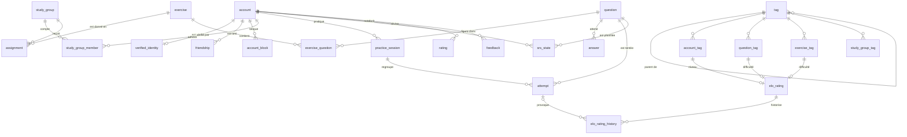

# Modèle métier — Plateforme d'apprentissage

> **Source de vérité :** `db/migrations/V0001__initial_schema.sql`. Ce document explique le *pourquoi* ; le script fait foi pour le *quoi*. Toute modification passe par les deux, dans le même commit.
> **Conventions :** `STYLE_SQL.md` (noms en anglais, `snake_case`, une table = un concept au singulier).
> **Notation :** colonne `Null` vide = `NOT NULL`. Les colonnes `created_at`, `updated_at` et `archived_at` suivent toujours la même règle (§ 8) et ne sont pas redécrites dans chaque table.

## Sommaire

0. [Référentiels](#0-référentiels)
1. [Comptes & social](#1-comptes--social)
2. [Contenu pédagogique](#2-contenu-pédagogique)
3. [Tags](#3-tags)
4. [Devoirs & pratique](#4-devoirs--pratique)
5. [Apprentissage adaptatif (SRS & Elo)](#5-apprentissage-adaptatif-srs--elo)
6. [Avis & signalements](#6-avis--signalements)
7. [Flux d'une réponse](#7-flux-dune-réponse)
8. [Décisions de modélisation](#8-décisions-de-modélisation)
9. [Questions ouvertes](#9-questions-ouvertes)
10. [Problèmes identifiés](#10-problèmes-identifiés)
11. [TODO](#11-todo)
12. [Annexe — correspondance avec la v1](#12-annexe--correspondance-avec-la-v1)

## Vue d'ensemble

---

## 0. Référentiels

### `country`

Pays ISO 3166-1 alpha-2. Clé naturelle : un code international stable n'a pas besoin d'identifiant technique.

| Colonne | Type | Null | Remarque |
|---|---|---|---|
| country_code | CHAR(2) | | PK, majuscules (`FR`) |
| name | VARCHAR(100) | | |

---

## 1. Comptes & social

### `account`

Un compte, quelle que soit la nature de son titulaire.

| Colonne | Type | Null | Remarque |
|---|---|---|---|
| account_id | BIGINT | | PK, identité |
| account_type | VARCHAR(20) | | `standard`, `anonymous`, `organization` |
| username | VARCHAR(50) | | pseudo, unique sans tenir compte de la casse |
| email | VARCHAR(254) | oui | unique sans tenir compte de la casse |
| email_verified_at | TIMESTAMPTZ | oui | NULL = email non vérifié |
| password_hash | VARCHAR(255) | oui | Argon2id au format PHC (paramètres et sel inclus) ; poivre côté application |
| bio | TEXT | oui | |
| last_login_at | TIMESTAMPTZ | oui | |
| created_at, updated_at, archived_at | TIMESTAMPTZ | | voir § 8 |

Règles :
- un compte actif non anonyme a un email **et** un mot de passe ;
- `email_verified_at` n'existe pas sans email ;
- « vérifié » n'est pas un type de compte : c'est l'existence d'une ligne `verified_identity`.

### `verified_identity`

Extension 1:1 de `account` pour une personne physique vérifiée (base d'une future attestation de compétences).

| Colonne | Type | Null | Remarque |
|---|---|---|---|
| account_id | BIGINT | | PK, FK → account |
| first_name | VARCHAR(100) | | |
| last_name | VARCHAR(100) | | |
| birth_date | DATE | | |
| birth_place | VARCHAR(100) | oui | |
| verified_at | TIMESTAMPTZ | | |
| updated_at | TIMESTAMPTZ | | |

Retirés par minimisation RGPD : email (doublon de `account`), nationalité, localisation, téléphone, genre, taille, poids, métier. Voir § 9.

### `friendship`

Amitié, relation symétrique stockée une seule fois.

| Colonne | Type | Null | Remarque |
|---|---|---|---|
| lower_account_id | BIGINT | | PK, FK → account, le plus petit des deux identifiants |
| higher_account_id | BIGINT | | PK, FK → account |
| requester_account_id | BIGINT | | l'un des deux : qui a envoyé la demande |
| friendship_status | VARCHAR(20) | | `pending`, `accepted` |
| requested_at | TIMESTAMPTZ | | |
| accepted_at | TIMESTAMPTZ | oui | renseigné si et seulement si `accepted` |

### `account_block`

Blocage orienté : *qui* bloque *qui*. Sorti de `friendship`, où `blocked` ne disait pas qui avait bloqué.

| Colonne | Type | Null | Remarque |
|---|---|---|---|
| blocker_account_id | BIGINT | | PK, FK → account |
| blocked_account_id | BIGINT | | PK, FK → account, différent du précédent |
| blocked_at | TIMESTAMPTZ | | |

### `study_group`

Groupe d'étude : classe d'un professeur, groupe d'amis, club.

| Colonne | Type | Null | Remarque |
|---|---|---|---|
| study_group_id | BIGINT | | PK |
| created_by_account_id | BIGINT | oui | FK → account ; historique, le propriétaire actuel est le membre `owner` |
| name | VARCHAR(100) | | |
| description | TEXT | oui | |
| created_at, updated_at, archived_at | TIMESTAMPTZ | | |

### `study_group_member`

| Colonne | Type | Null | Remarque |
|---|---|---|---|
| study_group_id | BIGINT | | PK, FK → study_group |
| account_id | BIGINT | | PK, FK → account |
| member_role | VARCHAR(20) | | `owner`, `admin`, `member` : ce que le membre peut faire |
| member_status | VARCHAR(20) | | `invited`, `active`, `banned` : où en est l'adhésion |
| created_at | TIMESTAMPTZ | | invitation ou demande |
| joined_at | TIMESTAMPTZ | oui | obligatoire si `active` |

Règle : un seul `owner` par groupe.

---

## 2. Contenu pédagogique

`publication_status`, commun à `exercise` et `question` :

| Valeur | Sens |
|---|---|
| `private` | visible par l'auteur, et par un groupe via un devoir (« le prof crée ses exercices en local ») |
| `pending_review` | proposé à la communauté, en attente de validation |
| `published` | validé, visible par tous |
| `rejected` | refusé : doublon, droit d'auteur, thème interdit… |

### `exercise`

| Colonne | Type | Null | Remarque |
|---|---|---|---|
| exercise_id | BIGINT | | PK |
| author_account_id | BIGINT | | FK → account |
| exercise_type | VARCHAR(20) | | `quiz`, `deck`, `mixed` |
| title | VARCHAR(200) | | |
| description | TEXT | oui | |
| question_count | INT | oui | questions tirées à chaque passage ; NULL = toutes |
| publication_status | VARCHAR(20) | | voir ci-dessus |
| source | TEXT | oui | |
| resource_uri | VARCHAR(500) | oui | |
| created_at, updated_at, archived_at | TIMESTAMPTZ | | |

### `question`

| Colonne | Type | Null | Remarque |
|---|---|---|---|
| question_id | BIGINT | | PK |
| author_account_id | BIGINT | | FK → account |
| question_type | VARCHAR(20) | | voir tableau ci-dessous |
| instruction | TEXT | oui | consigne : « calculer de tête », « traduire »… |
| content | TEXT | | énoncé |
| publication_status | VARCHAR(20) | | |
| source | TEXT | oui | |
| resource_uri | VARCHAR(500) | oui | |
| created_at, updated_at, archived_at | TIMESTAMPTZ | | |

| `question_type` | Ancien nom |
|---|---|
| `flashcard` | Flashcard |
| `true_false` | Vrai/Faux |
| `single_choice` | QCU |
| `multiple_choice` | QCM |
| `short_answer` | QSimple |
| `multi_answer` | QMultiple |
| `fill_in_blank` | À trou |
| `ordering` | classement (nouveau type explicite) |
| `error_spotting` | Repérage erreur |
| `span_selection` | Repérage simple |
| `open_ended` | question ouverte (cahier des charges) |

La colonne `note` (« justesse de la question ») est supprimée : c'est une valeur calculable à partir de `rating` (§ 8).

### `exercise_question`

Une question peut servir dans plusieurs exercices.

| Colonne | Type | Null | Remarque |
|---|---|---|---|
| exercise_id | BIGINT | | PK, FK → exercise |
| question_id | BIGINT | | PK, FK → question |
| sort_order | INT | | ordre d'affichage s'il n'y a pas de tirage aléatoire |
| added_at | TIMESTAMPTZ | | |

### `answer`

Élément de réponse attendu ou proposé pour une question (ancienne table `Response`).

| Colonne | Type | Null | Remarque |
|---|---|---|---|
| answer_id | BIGINT | | PK |
| question_id | BIGINT | | FK → question |
| answer_type | VARCHAR(20) | | voir tableau ci-dessous |
| content | TEXT | oui | texte de la proposition ou de la solution |
| explanation | TEXT | oui | sens, exemple |
| is_correct | BOOLEAN | | `FALSE` par défaut ; `TRUE` pour tout type sans distracteur |
| sort_order | INT | oui | obligatoire pour `gap` et `ordering_item` |
| span_start | INT | oui | début du passage dans `question.content` (caractères, inclus) |
| span_end | INT | oui | fin du passage (exclue) |
| resource_uri | VARCHAR(500) | oui | |
| created_at, updated_at | TIMESTAMPTZ | | |

| `answer_type` | Sens |
|---|---|
| `choice` | proposition d'un QCM, QCU, vrai/faux ; `is_correct` désigne la bonne |
| `solution` | réponse attendue ou correction |
| `gap` | contenu d'un trou ; `sort_order` = numéro du trou |
| `ordering_item` | élément à classer ; `sort_order` = position attendue |
| `span` | passage à repérer : `span_start` et `span_end` obligatoires, `span_end > span_start` |

L'ancien champ JSON `position` devient deux colonnes entières : la base peut alors vérifier leur cohérence.

---

## 3. Tags

### `tag`

Arborescence des domaines de compétence.

| Colonne | Type | Null | Remarque |
|---|---|---|---|
| tag_id | BIGINT | | PK |
| parent_tag_id | BIGINT | oui | FK → tag ; NULL = racine |
| country_code | CHAR(2) | oui | FK → country ; contexte national, NULL = universel |
| name | VARCHAR(100) | | |
| created_at, archived_at | TIMESTAMPTZ | | |

Règles :
- unicité de (`parent_tag_id`, `name`, `country_code`), où deux NULL comptent comme égaux : « Histoire > Sport » ≠ « Sport », mais deux « Sport » racines sont refusés ;
- un tag n'est pas son propre parent ; un parent ne peut pas être supprimé tant qu'il a des enfants (on archive) ;
- les cycles plus longs (A → B → A) sont à empêcher côté application.

### Associations

Une table par type d'entité, toutes sur le même modèle : (`<entité>_id`, `tag_id`) en clé primaire, `created_at`.

| Table | Sens |
|---|---|
| `account_tag` | l'utilisateur pratique ce tag ; créée automatiquement à sa première réponse à une question portant ce tag ; porte son Elo |
| `question_tag` | domaine de la question ; porte la difficulté Elo de la question |
| `exercise_tag` | domaine de l'exercice ; porte la difficulté Elo de l'exercice |
| `study_group_tag` | thèmes du groupe |

---

## 4. Devoirs & pratique

### `assignment`

Un exercice donné à un groupe sur une période (cas d'usage « devoirs à la maison »).

| Colonne | Type | Null | Remarque |
|---|---|---|---|
| assignment_id | BIGINT | | PK |
| study_group_id | BIGINT | | FK → study_group |
| exercise_id | BIGINT | | FK → exercise |
| assigned_by_account_id | BIGINT | | FK → account |
| instructions | TEXT | oui | |
| opens_at | TIMESTAMPTZ | | début de disponibilité |
| due_at | TIMESTAMPTZ | oui | échéance, après `opens_at` |
| pass_threshold_ratio | NUMERIC(4,3) | oui | barre minimum à atteindre (0,850 pour 17/20) plutôt qu'une moyenne de groupe |
| created_at, updated_at, archived_at | TIMESTAMPTZ | | |

### `practice_session`

Une séance de pratique, qui regroupe les tentatives faites d'une traite.

| Colonne | Type | Null | Remarque |
|---|---|---|---|
| practice_session_id | BIGINT | | PK |
| account_id | BIGINT | | FK → account |
| session_type | VARCHAR(20) | | voir tableau ci-dessous |
| exercise_id | BIGINT | oui | FK → exercise |
| assignment_id | BIGINT | oui | FK → assignment |
| tag_id | BIGINT | oui | FK → tag ; thème ciblé |
| started_at | TIMESTAMPTZ | | |
| finished_at | TIMESTAMPTZ | oui | NULL = séance abandonnée ou en cours |

| `session_type` | Contexte obligatoire |
|---|---|
| `free` | — |
| `exercise` | `exercise_id` |
| `assignment` | `assignment_id` (l'exercice vient du devoir, `exercise_id` reste NULL) |
| `daily_challenge` | — |
| `placement_test` | `tag_id` conseillé |
| `srs_review` | — |

### `attempt`

La réponse d'un utilisateur à une question (ancienne table `UserResponse`).

| Colonne | Type | Null | Remarque |
|---|---|---|---|
| attempt_id | BIGINT | | PK |
| practice_session_id | BIGINT | | FK → practice_session ; l'utilisateur se retrouve par la séance |
| question_id | BIGINT | | FK → question |
| given_answer | TEXT | oui | réponse saisie |
| score_ratio | NUMERIC(4,3) | | justesse objective : 0 = faux, 1 = juste, entre les deux = partiel ; score réel *R* de l'Elo |
| recall_grade | SMALLINT | oui | qualité de rappel SM-2 (0 à 5), auto-évaluée pour une flashcard |
| duration_ms | INT | oui | temps de réponse |
| answered_at | TIMESTAMPTZ | | |

`score_ratio` et `recall_grade` sont distincts : une réponse juste trouvée péniblement (`score_ratio = 1`, `recall_grade = 3`) ne doit pas espacer la révision autant qu'une réponse immédiate (`recall_grade = 5`).

---

## 5. Apprentissage adaptatif (SRS & Elo)

### `srs_state`

État de répétition espacée SM-2, par utilisateur et par question (niveau micro).

| Colonne | Type | Null | Remarque |
|---|---|---|---|
| account_id | BIGINT | | PK, FK → account |
| question_id | BIGINT | | PK, FK → question |
| srs_status | VARCHAR(20) | | `new`, `learning`, `review`, `relearning`, `suspended` (vocabulaire Anki) |
| repetition_count | INT | | répétitions réussies consécutives |
| ease_factor | REAL | | 2,5 au départ, 1,3 minimum (plancher SM-2) |
| interval_days | INT | | intervalle courant |
| lapse_count | INT | | nombre d'oublis après apprentissage |
| due_at | TIMESTAMPTZ | oui | prochaine révision ; NULL = jamais vue |
| last_reviewed_at | TIMESTAMPTZ | oui | |
| created_at | TIMESTAMPTZ | | |

Les anciens `attempts_nb` et `successes_nb` sont supprimés : ils se calculent à partir de `attempt`.

### `elo_rating`

Elo d'un sujet dans un tag (niveau macro). Le sujet est **soit** un compte (son niveau), **soit** une question ou un exercice (sa difficulté).

| Colonne | Type | Null | Remarque |
|---|---|---|---|
| elo_rating_id | BIGINT | | PK |
| tag_id | BIGINT | | |
| account_id | BIGINT | oui | avec `tag_id` : FK → account_tag |
| question_id | BIGINT | oui | avec `tag_id` : FK → question_tag |
| exercise_id | BIGINT | oui | avec `tag_id` : FK → exercise_tag |
| rating | DOUBLE PRECISION | | 1500 au départ |
| game_count | INT | | nombre de « parties » jouées |
| updated_at | TIMESTAMPTZ | | |

Règles :
- exactement un sujet renseigné (arc exclusif) ;
- un seul Elo par sujet et par tag ;
- un Elo ne peut exister que si l'association correspondante existe.

### `elo_rating_history`

| Colonne | Type | Null | Remarque |
|---|---|---|---|
| elo_rating_history_id | BIGINT | | PK |
| elo_rating_id | BIGINT | | FK → elo_rating |
| attempt_id | BIGINT | oui | FK → attempt : la tentative qui a provoqué la variation ; NULL si recalcul global |
| rating_before | DOUBLE PRECISION | | |
| rating_after | DOUBLE PRECISION | | |
| changed_at | TIMESTAMPTZ | | |

---

## 6. Avis & signalements

### `rating`

Note de 1 à 5 étoiles d'un contenu, une seule par auteur et par contenu.

| Colonne | Type | Null | Remarque |
|---|---|---|---|
| rating_id | BIGINT | | PK |
| author_account_id | BIGINT | | FK → account |
| question_id | BIGINT | oui | FK → question |
| exercise_id | BIGINT | oui | FK → exercise |
| star_count | SMALLINT | | 1 à 5 |
| comment | TEXT | oui | |
| created_at, updated_at | TIMESTAMPTZ | | |

Une seule cible renseignée. Les personnes ne sont pas notées (§ 8).

### `feedback`

Retour écrit, traité par la modération.

| Colonne | Type | Null | Remarque |
|---|---|---|---|
| feedback_id | BIGINT | | PK |
| author_account_id | BIGINT | | FK → account |
| feedback_type | VARCHAR(20) | | `comment`, `suggestion`, `error_report`, `abuse_report` |
| question_id | BIGINT | oui | cible |
| exercise_id | BIGINT | oui | cible |
| study_group_id | BIGINT | oui | cible |
| target_account_id | BIGINT | oui | cible (signalement d'un compte) |
| content | TEXT | | |
| feedback_status | VARCHAR(20) | | `open`, `resolved`, `dismissed` |
| handled_by_account_id | BIGINT | oui | FK → account, modérateur |
| handled_at | TIMESTAMPTZ | oui | renseigné si et seulement si le statut n'est plus `open` |
| created_at, updated_at | TIMESTAMPTZ | | |

Une seule cible renseignée.

---

## 7. Flux d'une réponse

1. L'utilisateur ouvre une `practice_session` (ou en reprend une).
2. Il répond : une ligne `attempt` (`score_ratio`, `recall_grade` éventuel, `duration_ms`).
3. **Moteur SRS** (niveau micro) : met à jour `srs_state` (`ease_factor`, `interval_days`, `due_at`) à partir de `recall_grade`.
4. **Moteur Elo** (niveau macro), pour chaque tag de la question :
   - crée `account_tag` et l'`elo_rating` du compte s'ils n'existent pas ;
   - calcule la probabilité théorique *P* de réussite à partir des deux Elo ;
   - prend `score_ratio` comme score réel *R* ;
   - met à jour l'Elo du compte et celui de la question, avec une ligne `elo_rating_history` chacun.
5. Les nouvelles valeurs alimentent la file de révision (`due_at`) et la recommandation (écart d'Elo).

Les trois couches sont orthogonales : les **tags** disent à quel domaine appartient quoi, **SM-2** dit quand revoir une question, l'**Elo** dit quel est le niveau de l'utilisateur et la difficulté du contenu dans un domaine. Les calculs se font dans l'application ; la base stocke l'état et garantit sa cohérence.

---

## 8. Décisions de modélisation

| Décision | Pourquoi |
|---|---|
| `archived_at TIMESTAMPTZ NULL` plutôt qu'un booléen `is_archived` | Une seule colonne donne l'état (NULL = actif) **et** la date. L'ancien `is_archived` était typé `Timestamp` : son nom et son type se contredisaient. |
| Suppression RGPD = anonymisation du compte | Le contenu créé (questions, exercices) et les statistiques survivent ; l'identité disparaît (pseudo remplacé, email et mot de passe effacés, `verified_identity` supprimée). |
| `created_at` / `updated_at` / `archived_at` partout où c'est utile | Même nom, même type, même sens dans toutes les tables. `updated_at` est tenu par un déclencheur, donc juste quel que soit le client. |
| `account` au lieu de `User`, `study_group` au lieu de `Group` | `user` et `group` sont des mots réservés en SQL, et les préfixer (`app_user`) ne dit rien de plus. « Compte » colle aussi aux types de comptes. |
| Types de comptes : `standard`, `anonymous`, `organization` | « Physique (vérifié) » devient l'existence d'une `verified_identity` : sinon deux sources de vérité pourraient se contredire. |
| Classe mère des entités taguées : classe oui, table non | Décision v1 conservée. En C#, une interface `ITaggable` ; en base, une table d'association par type d'entité, chacune avec de vraies clés étrangères. |
| Plus d'association polymorphe (`entity_type` + `entity_id`) | La base ne pouvait pas vérifier que `entity_id` existait. Remplacée par une table par type (tags) ou par un arc exclusif contrôlé par `CHECK` (Elo, avis, retours). |
| Fusionner associations de tags et Elo : **non** | Décision v1 conservée. `elo_rating` reste une table à part, mais rattachée à l'association par une clé étrangère composite : pas d'Elo sans association. |
| Fusionner associations de tags et SM-2 : **non** (proposé) | SM-2 travaille au niveau de la question (micro), les tags au niveau du domaine (macro). |
| Fusionner Elo et SM-2 : **non** au départ | Décision v1 conservée. Couplage éventuel plus tard au niveau macro (« ça fait longtemps que tu n'as pas fait d'exercice de ce niveau »). |
| `score_ratio` (0 à 1) au lieu de `result` 0 à 255 | Le 0-255 venait du `TINYINT` ; un ratio est directement le score *R* de l'Elo et gère le partiel (QCM à plusieurs bonnes réponses). |
| Durée en `duration_ms INT` | Unité dans le nom, type portable, calculs simples. |
| `answer` / `attempt` au lieu de `Response` / `UserResponse` | Trois sens de « réponse » se croisaient : réponse attendue, réponse de l'utilisateur, colonne `answer`. |
| `rating` au lieu de `Review` | « review » est déjà un état SRS (`srs_status = 'review'`). Un concept = un nom. |
| Pas de note sur les personnes | Public jeune visé : noter un utilisateur ouvre la porte au harcèlement. Un comportement problématique se signale (`feedback` de type `abuse_report`). |
| `question.note` et `srs.attempts_nb` / `successes_nb` supprimés | Calculables à partir de `rating` et `attempt`. Une valeur stockée deux fois finit par diverger ; on ajoutera un cache (vue matérialisée) si une mesure le justifie. |
| `friendship` sans `blocked` + table `account_block` | Le blocage est orienté ; dans une relation symétrique, on ne savait pas qui avait bloqué. Ajout de `requester_account_id` pour la même raison. |
| Unicité des tags sur (`parent_tag_id`, `name`, `country_code`) | Résout « Histoire > Sport ≠ Sport ». `NULLS NOT DISTINCT` évite deux racines homonymes. |
| Suppression d'un tag parent interdite | Avec l'ancien `ON DELETE SET NULL`, « Histoire > Sport » devenait silencieusement une racine « Sport », en conflit avec la vraie. |
| `assignment` et `practice_session` ajoutées | Cas d'usage du cahier des charges (devoirs, défi quotidien, test de niveau) qui n'avaient pas de place dans le modèle. |

---

## 9. Questions ouvertes

| Question | Piste |
|---|---|
| Versionner les questions ? Une question corrigée après des tentatives change le sens des anciennes réponses. | Table `question_version`, `attempt` pointant vers la version. À trancher avant d'ouvrir les contributions. |
| Consentement parental (public jeune) | En France, consentement des parents sous 15 ans pour le traitement fondé sur le consentement (RGPD art. 8). Impose de connaître l'âge à l'inscription. À faire valider. |
| Données retirées de `verified_identity` (nationalité, localisation, téléphone, genre, taille, poids, métier) | Ne les réintroduire qu'avec une finalité précise. Taille et poids peuvent être considérés comme des données de santé : table séparée et consentement explicite si un module sport les exige. |
| Identité d'une organisation (`organization`) | Raison sociale, SIRET… : table `organization_identity` à définir. |
| Table d'abréviations (M. ⇒ Monsieur, Mme, abréviations de voie…) | à étudier |
| Tags de niveau (école, collège, lycée, université / CP → Bac+8) | → niveau de découverte |
| Niveau initial déclaré par le créateur d'un exercice | Fixer l'Elo de départ de l'exercice à partir du niveau déclaré au lieu de 1500. |
| Pré-scorer les exercices par rapport aux exercices du même tag | à définir |
| Niveau de découverte | mode révision / apprentissage + limite supérieure d'écart d'Elo |
| Adapter SM-2 et Elo non pas à la mémoire mais à un muscle | piste |
| Champs de vérification croisée pour la conformité d'un exercice | à créer (probablement une table de validations par contributeur, liée à `pending_review`) |
| Passer de SM-2 à un autre algorithme (SM-19, FSRS) | Ajouter les colonnes propres au nouvel algorithme dans `srs_state`, ou une table par algorithme. |
| Identifiants exposés dans les URL | `BIGINT` séquentiels faciles à énumérer : soit un contrôle d'accès systématique, soit une colonne `public_id UUID` pour les URL publiques. |

---

## 10. Problèmes identifiés

| Problème | Statut |
|---|---|
| **Tags contextuels** : « Quelle personne a remporté la médaille d'or aux Jeux olympiques ? » ⇒ `Histoire > Sport` ≠ `Sport` (racine) | Résolu par l'unicité (`parent_tag_id`, `name`, `country_code`). |
| **Tag sans association** : l'utilisateur répond à une question dont il n'a pas encore le tag | Règle applicative : création de `account_tag` et de son `elo_rating` à la première réponse (§ 7). La base garantit qu'aucun Elo n'existe sans association. |
| **Biais de population** : s'il n'y a que des utilisateurs forts, les difficultés se resserrent | Ouvert. |
| **Cycles dans l'arborescence des tags** | Ouvert : contrôle applicatif ou déclencheur. |
| **Cohérence entre tables** (`verified_identity` réservée aux comptes `standard`, question d'une tentative appartenant à l'exercice de la séance…) | Contrôlé par l'application : une contrainte `CHECK` ne voit qu'une ligne. |

---

## 11. TODO

- [ ] Arborescence des tags (fichier séparé)
- [ ] Liste complète des pays (script de données)
- [ ] Éditeur de texte riche (souligné, police, barré, italique…) : définir le format stocké dans `content` (Markdown ou HTML filtré contre le XSS)
- [ ] Forum, suggestions, signalements, remarques : `feedback` couvre les retours ; le forum reste à modéliser
- [ ] Récompenses : badges, succès, séries de jours (« flamme »)
- [ ] Notifications et rappels
- [ ] Médias : une table `media` si un contenu doit porter plusieurs ressources (aujourd'hui `resource_uri` unique)
- [ ] Méthodes CRUD et autres méthodes nécessaires
- [x] Reprendre l'UML → diagramme Mermaid en tête de document

---

## 12. Annexe — correspondance avec la v1

À supprimer une fois la migration des notes et du code terminée.

| v1 | v2 |
|---|---|
| `User` / `app_user` | `account` |
| `User.pseudo`, `pwd`, `date_connexion` | `username`, `password_hash`, `last_login_at` |
| `User.is_archived` | `archived_at` |
| `date_creation`, `date_modification` | `created_at`, `updated_at` |
| `UserVerified` | `verified_identity` |
| `Friend` (`status = blocked`) | `friendship` + `account_block` |
| `Group` / `app_group`, `UsersGroup` | `study_group`, `study_group_member` |
| `UsersGroup.role = banned` | `member_status = 'banned'` |
| `QuestionsExercise` | `exercise_question` (+ `sort_order`) |
| `Exercise.type`, `question_nb` | `exercise_type`, `question_count` |
| `Question.type`, `text` | `question_type`, `content` |
| `Response` | `answer` |
| `Response.explaining`, `correct`, `order`, `position` | `explanation`, `is_correct`, `sort_order`, `span_start` + `span_end` |
| `UserResponse` | `attempt` (+ `practice_session`) |
| `UserResponse.result`, `answer`, `duration` | `score_ratio`, `given_answer`, `duration_ms` |
| `SM-2` / `srs_sm2` | `srs_state` |
| `score`, `interval`, `date_next`, `repetition` | `ease_factor`, `interval_days`, `due_at`, `repetition_count` |
| `Tag.nationality` | `country_code` (FK → `country`) |
| `TagsAssociation` | `account_tag`, `question_tag`, `exercise_tag`, `study_group_tag` |
| `Elo.tagassociation_id`, `score`, `parties_nb` | sujet + `tag_id`, `rating`, `game_count` |
| `EloHistory.score_old`, `score_new` | `rating_before`, `rating_after` (+ `attempt_id`) |
| `Review` | `rating` (`note` → `star_count`) |
| `Feedback` | `feedback` (+ type, statut, modération) |
