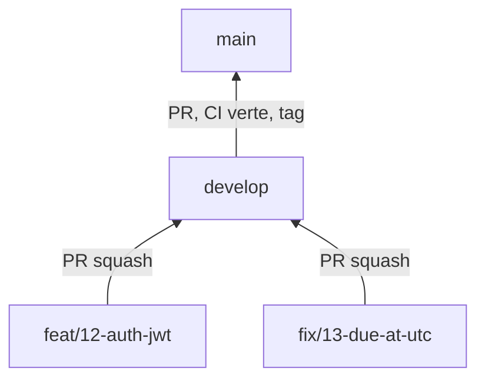

# Workflow Git — conventions de versionnage et de collaboration

> **Portée :** toute l'histoire du dépôt SIGRE — branches, commits, tags, demandes de fusion.
> **Documents liés :** `ABOUT_PROJECT.md` § 2.10 (CI/CD dès le premier jour), `TODO.md` (étape 1 de la feuille de route), `README.md` (clonage, installation).
> **Contexte :** développement solo aujourd'hui, hébergé sur GitHub ; auto-hébergement envisagé plus tard (Forgejo). Le workflow est conçu pour fonctionner seul maintenant **et** à plusieurs demain, sans le réapprendre.

## Sommaire

1. [Modèle de branches](#1-modèle-de-branches)
2. [Nommage des branches](#2-nommage-des-branches)
3. [Messages de commit](#3-messages-de-commit)
4. [Cycle de travail habituel (solo)](#4-cycle-de-travail-habituel-solo)
5. [Demandes de fusion, même seul](#5-demandes-de-fusion-même-seul)
6. [Versions et tags](#6-versions-et-tags)
7. [Ce que la CI exige](#7-ce-que-la-ci-exige)
8. [Migration vers l'auto-hébergement](#8-migration-vers-lauto-hébergement)
9. [Commandes de vérification utiles](#9-commandes-de-vérification-utiles)

---

## 1. Modèle de branches



- **`main`** : la branche de production. Toujours déployable, toujours verte. Protégée : aucune poussée directe, uniquement des fusions par PR dont la CI est passée. Chaque fusion sur `main` est taguée (§ 6).
- **`develop`** : la branche d'intégration. C'est là que les fonctionnalités se rejoignent et sont testées ensemble. Les branches de travail fusionnent **vers** `develop` ; quand `develop` est stable et validée, elle part sur `main` par PR.
- **Branches de travail** : une branche par tâche, courte (quelques jours maximum), fusionnée puis supprimée. C'est là qu'on committe au quotidien.

Pourquoi garder `develop` alors qu'on est seul : parce que `main` doit refléter *ce qui est publié*, pas *ce qui est en cours*. Le jour où un déploiement part en prod, on veut pouvoir dire « `main` = ce qui tourne », sans se demander si la moitié d'une fonctionnalité y est déjà.

## 2. Nommage des branches

Format : **`<type>/<n°issue>-<slug>`** — le n° d'issue renvoie au suivi (GitHub Issues aujourd'hui) ; le slug en `kebab-case`, court et en anglais (identifiants anglais, comme partout) :

| Type | Usage | Exemple |
|---|---|---|
| `feat` | nouvelle fonctionnalité | `feat/12-auth-jwt` |
| `fix` | correction de bug | `fix/13-due-at-utc` |
| `docs` | documentation seule | `docs/05-readme-install` |
| `refactor` | remaniement sans changement de comportement | `refactor/07-extract-srs-engine` |
| `chore` | outillage, dépendances, CI | `chore/09-ci-docker-build` |

- Une branche par **tâche**, pas par personne : la branche porte ce qu'elle fait, pas qui la fait. Les branches personnelles n'arriveront que si l'équipe grandit, et suivront `dev/<prenom>/<type>-<slug>` (ex. `dev/arthur/feat-auth-jwt`) — la convention est actée maintenant pour ne pas en inventer une autre plus tard.
- Pas de branche dont le nom diffère d'une existante par la casse seule (leçon de l'ancien workflow).
- La branche est supprimée après fusion : le nom est dans l'historique de la PR, garder la branche ne sert qu'à encombrer.

## 3. Messages de commit

Format : **`type(scope): message`** — le message en **français, à l'impératif présent**, court et descriptif.

```text
feat(auth): ajoute la rotation du refresh token
fix(srs): corrige le calcul d'intervalle après une note de 2
docs(readme): détaille l'installation sous Windows
refactor(practice): extrait le moteur de sélection des questions
```

- `type` : `feat`, `fix`, `docs`, `refactor`, `chore`, `test` — les mêmes que les branches.
- `scope` : le module touché (`auth`, `srs`, `elo`, `practice`, `groups`, `api`, `db`, `ci`…) ; omis si le commit est transverse.
- **Un commit = un changement logique.** Un refactor et une fonctionnalité ne partagent jamais un commit. En revanche, un changement cohérent qui touche plusieurs couches (SQL + Rust + test) est **un** commit : c'est son unité logique.
- **Committer quand ça compile et que les tests passent**, pas à chaque micro-correction : les allers-retours de mise au point d'une même fonctionnalité sont regroupés (squash au moment de la fusion, § 5) ou commités une fois stabilisés. L'historique doit raconter l'évolution du projet, pas la session de débogage.
- La phrase d'impératif dit **ce que fait le commit** : « Ajoute », « Corrige », « Extrait » — jamais « modifie des fichiers » ni « wip ».

## 4. Cycle de travail habituel (solo)

```bash
# 1. Se synchroniser avant de commencer
git switch develop && git pull

# 2. Créer la branche de la tâche (une tâche = une issue)
git switch -c feat/12-auth-jwt

# 3. Travailler, committer régulièrement
git add -p                    # relire ce qu'on ajoute, pas tout ajouter aveuglément
git commit -m "feat(auth): ajoute la vérification Argon2id"
git push -u origin feat/12-auth-jwt

# 4. Fonctionnalité prête : ouvrir la PR vers develop (§ 5)
```

- `git add -p` plutôt que `git add .` : on relit son propre diff avant de le committer — la moitié des erreurs s'attrapent là.
- Une branche longue vivante se resynchronise régulièrement depuis `develop` (`git fetch && git rebase develop` en solo, `merge` si d'autres y travaillent) pour ne pas accumuler les conflits.
- Pousser sa branche tous les jours, même incomplète : c'est la sauvegarde, et la CI y donne un premier avis.

## 5. Demandes de fusion, même seul

Travailler seul ne dispense pas de la PR : c'est le seul moment où la CI a son mot à dire **avant** que le code n'entre dans `develop`, et c'est le journal de bord de chaque fonctionnalité (la PR référence l'issue, l'issue référence la tâche).

- **PR de la branche vers `develop`, fusion en « squash merge »** : les commits intermédiaires de mise au point deviennent un seul commit propre `feat(auth): … (#12)` sur `develop`. L'historique de `develop` reste lisible : une entrée par fonctionnalité.
- **La CI doit être verte** sur la PR (§ 7). Rouge = pas de fusion, même si « c'est juste le lint ».
- **L'auteur relit sa propre PR ligne à ligne** avant de fusionner : se relire 20 minutes plus tard vaut une revue d'un tiers.
- La PR a un court descriptif : ce qu'elle apporte, comment le tester, ce qu'elle ne couvre pas encore.
- `develop` → `main` suit exactement la même mécanique : PR, CI verte, squash si plusieurs commits, puis tag (§ 6).

## 6. Versions et tags

- **`main` est taguée en versionnement sémantique** : `vX.Y.Z`.
  - **Z** (correctif) : bug corrigé, aucun changement de comportement attendu (`v1.0.1`).
  - **Y** (fonctionnalité) : ajout rétrocompatible (`v1.1.0`).
  - **X** (rupture) : changement de contrat (API, base) — le passage `/api/v1` → `/api/v2` sera un `v2.0.0`.
- Le tag se pose **au moment de la fusion sur `main`** (ou juste après), avec un message de release (`git tag -a v1.0.0 -m "…"`), puis `git push origin v1.0.0`. Un tag = un état déployable = une note de version (le changelog v1 se fera d'abord avec les messages de PR).
- Tant que le produit n'est pas publié, on reste en `v0.Y.Z` : `v0` signale « le contrat peut encore bouger » sans casser la discipline.

## 7. Ce que la CI exige

Sur chaque PR (GitHub Actions, `ABOUT_PROJECT.md` § 2.10), dans l'ordre :

1. **Back** : `cargo fmt --check`, `cargo clippy -D warnings`, `cargo test`, `cargo sqlx prepare --check` (base de service éphémère).
2. **Front** : `npm run lint`, `npm run typecheck`, `npm run test`, `npm run build`.
3. **Build Docker** des images back et front (celles du déploiement, pas des artefacts jetables).

Rouge localement = rouge en CI : on lance `cargo test` et `npm run test` **avant** de pousser, pas après le refus du robot. La règle d'or : on ne fusionne jamais une PR rouge, et on ne pousse jamais directement sur `develop` ni `main`.

## 8. Migration vers l'auto-hébergement

L'auto-hébergement (Forgejo sur serveur perso, doctrine « Maîtrisé » du CDC) n'**invente rien** : il **déplace** l'existant.

- Le workflow, les branches, les tags et l'historique sont dans le dépôt Git lui-même : `git push` vers le nouveau dépôt les transporte intégralement. GitHub Issues et PR ne migrent pas, c'est le rôle des commits (`(#12)`) de garder la trace — une tâche d'export/résumé des issues ouvertes dans `TODO.md` précédera la bascule.
- La CI GitHub Actions se réécrit en CI Forgejo Runner (syntaxe compatible Actions, réécriture légère) : la liste des étapes (§ 7) ne change pas.
- Protection de `main` et `develop` à reconfigurer dans Forgejo (branches protégées, fusion squash uniquement).

## 9. Commandes de vérification utiles

- `git status` — branche courante, fichiers modifiés, avance/retard sur le distant.
- `git branch -vv` — branches locales, leur suivi distant et l'état `ahead`/`behind`.
- `git branch -r` — branches distantes connues.
- `git log --oneline -10` — les 10 derniers commits ; vérifier qu'une fusion/poussée a bien pris.
- `git --no-pager diff` — changements non commités ; à utiliser avant chaque commit (et `git diff --staged` après l'ajout).
- `git fetch --prune` — met à jour les refs distantes et supprime celles des branches supprimées (après nettoyage des branches fusionnées).
- `git tag -l` — liste des versions posées ; `git describe --tags` — où en est `main` par rapport au dernier tag.
- `git switch -` — retourner à la branche précédente (plus sûr que de retenir où on était).

---

## À retenir en priorité

Une tâche = une issue = une branche `type/n°-slug` ; messages `type(scope): français à l'impératif`, un commit = un changement logique ; fusion par PR (squash) vers `develop`, CI verte obligatoire ; `develop` → `main` par PR puis tag `vX.Y.Z` ; jamais de poussée directe ni de force-push sur `main`/`develop` ; `git add -p` et relecture de sa propre PR sont la revue de code du développeur solo.
