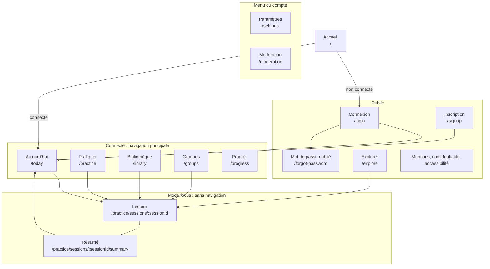
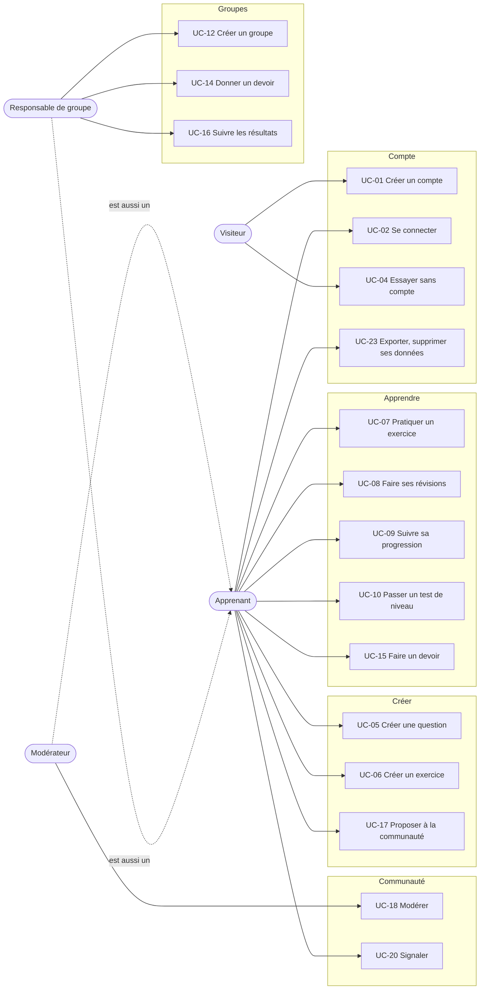
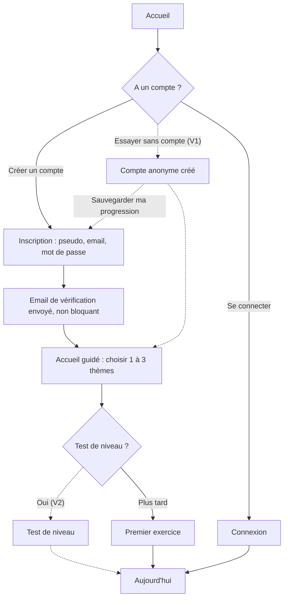
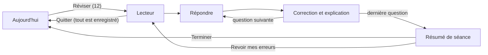
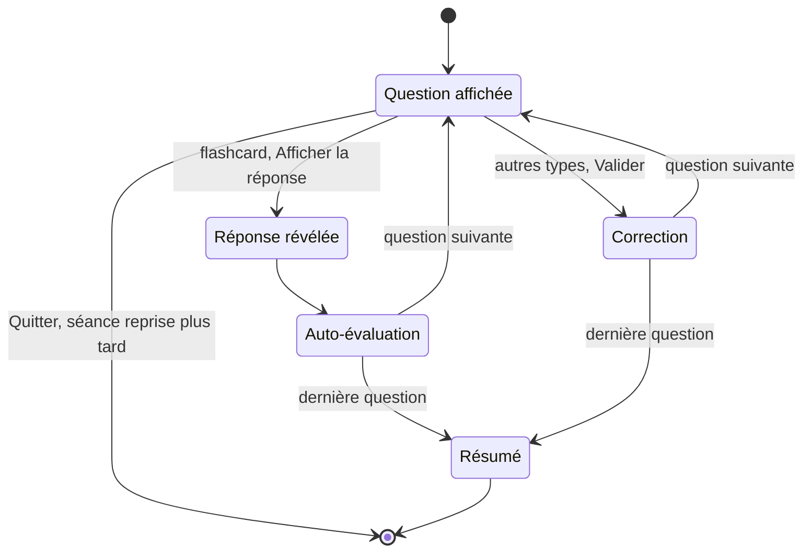
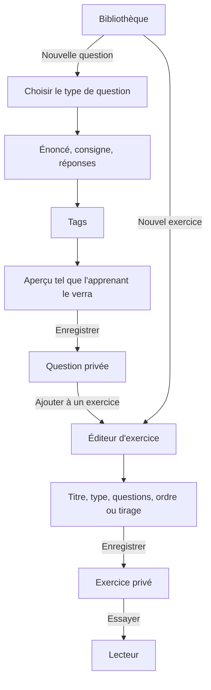
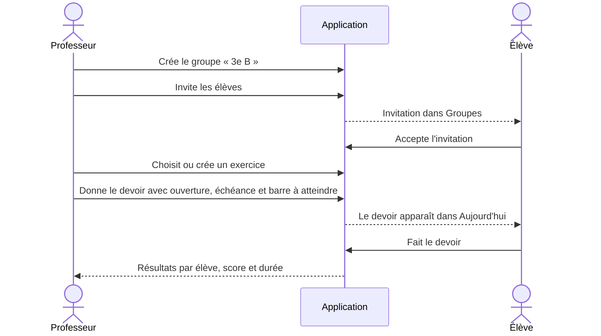
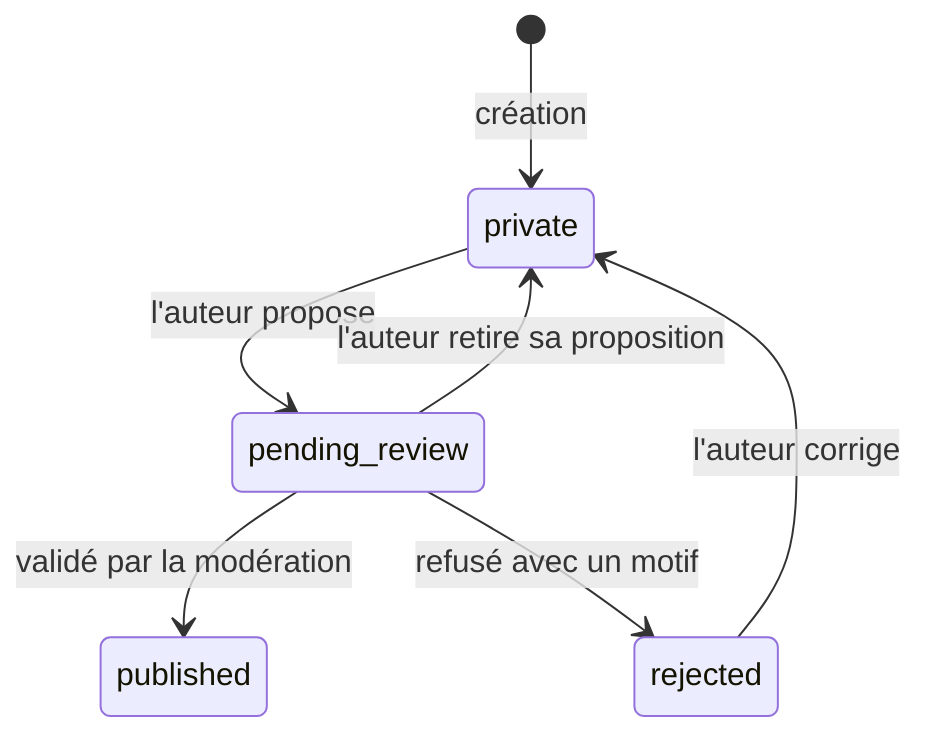
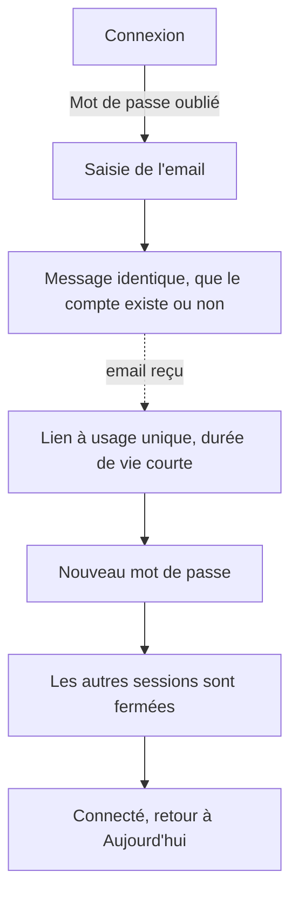
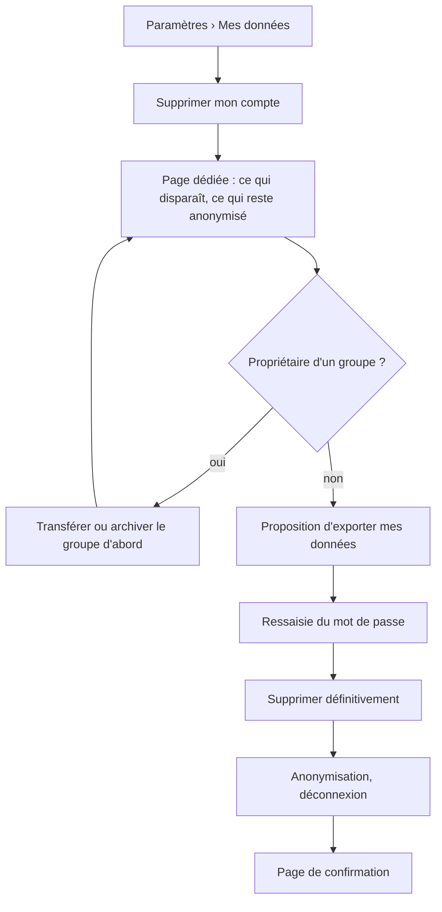

# Navigation — Plateforme d'apprentissage

> **Rôle du document :** qui peut aller où, et comment. Pages, droits, cas d'usage et parcours utilisateurs.
> Le *quoi* des données est dans `DOMAIN_MODEL.md`, le *pourquoi* du produit dans `ABOUT_PROJECT.md`, les routes d'API dans `STYLE_API.md`, les conventions de code front dans `STYLE_REACT.md`.
> **Règle d'or :** le front masque, l'API décide. Toute permission décrite ici est appliquée par le back ; le front se contente de ne pas proposer ce qui serait refusé.
> **Accessibilité :** RGAA 4.1 (référentiel français, fondé sur WCAG 2.1) et WCAG 2.2 niveau AA.
> **Versions :** chaque page et chaque cas d'usage est marqué `V1`, `V2` ou `Plus tard`, aligné sur la feuille de route V1 actée (`ABOUT_PROJECT.md` § 4) : les groupes et devoirs en font partie (étape 8), pas la contribution communautaire ni la modération.
> **Source de vérité des routes :** `frontend/src/app/routes.tsx` (voir `ARCHITECTURE.md` § 7). Toute route ajoutée ou modifiée l'est dans les deux, dans le même commit.

## Sommaire

1. [Principes UX/UI](#1-principes-uxui)
2. [Accessibilité](#2-accessibilité)
3. [Profils & droits](#3-profils--droits)
4. [Plan du site](#4-plan-du-site)
5. [Cas d'usage](#5-cas-dusage)
6. [Parcours utilisateurs](#6-parcours-utilisateurs)
7. [Écrans clés](#7-écrans-clés)
8. [Conventions React pour la navigation](#8-conventions-react-pour-la-navigation)
9. [Questions ouvertes & impacts sur le modèle](#9-questions-ouvertes--impacts-sur-le-modèle)

---

## 1. Principes UX/UI

| Principe | Règle concrète |
|---|---|
| Une action principale par écran | Un seul bouton primaire visible. Les autres actions sont secondaires ou dans un menu. |
| 7 à 14 éléments par écran (CDC) | Au-delà : regrouper, paginer ou replier. Compter les éléments interactifs, pas les textes. |
| Mobile d'abord | Conçu à 360 px de large, enrichi au-delà. Cibles tactiles de 44 × 44 px (le minimum WCAG est 24 × 24). |
| Le bouton Précédent marche toujours | Chaque page, onglet, filtre et numéro de page a son URL. Rien d'important ne vit uniquement dans l'état React. |
| Rien n'est perdu | Chaque réponse est enregistrée dès sa validation (`attempt`). Quitter une séance ne demande donc pas de confirmation. |
| Correction immédiate et bienveillante | On montre la bonne réponse et l'explication, pas une croix rouge. « Pas cette fois » plutôt que « Faux ». |
| Pas de motif sombre | Public jeune : notifications à activer soi-même, pas de culpabilisation, série de jours (« flamme ») avec jours de repos, pas de classement entre élèves par défaut. Objectif = une barre à atteindre, pas la moyenne du groupe (CDC). |
| Progression visible | « Question 3 sur 10 » en texte **et** barre de progression. |
| Langage simple | Phrases courtes, verbes d'action sur les boutons (« Réviser », « Donner le devoir »), pas de jargon (`srs_review` devient « Révisions »). Choisir une fois pour toutes tutoiement ou vouvoiement (proposition : tutoiement, cohérent avec le ton « jeu vidéo »). |
| Prévisible | Même action, même place, même nom sur tous les écrans. |

---

## 2. Accessibilité

### 2.1 Socle commun à toutes les pages

| Exigence | Mise en œuvre | Critère WCAG |
|---|---|---|
| Langue | `<html lang="fr">` ; `lang` sur tout passage dans une autre langue (questions de langues vivantes) | 3.1.1, 3.1.2 |
| Titre de page | `document.title` = « Titre de la page — Nom de l'app », mis à jour à chaque changement de route | 2.4.2 |
| Lien d'évitement | « Aller au contenu » : premier élément atteignable au clavier | 2.4.1 |
| Repères | `header`, `nav` (avec `aria-label`), un seul `main`, `footer` | 1.3.1 |
| Titres | Un `h1` par page, hiérarchie sans saut de niveau | 1.3.1, 2.4.6 |
| Focus après navigation | Une SPA ne le fait pas seule : à chaque changement de route, le focus va sur le `h1` (`tabIndex={-1}`) | 2.4.3 |
| Focus visible | Contour d'au moins 2 px, contrasté ; jamais `outline: none` sans remplacement ; jamais masqué par un en-tête ou une barre fixe | 2.4.7, 2.4.11 |
| Clavier | Tout est utilisable au clavier, dans un ordre logique, sans piège | 2.1.1, 2.1.2 |
| Contraste | Texte 4,5:1 ; grand texte et composants d'interface 3:1 (voir § 2.3) | 1.4.3, 1.4.11 |
| Couleur jamais seule | Juste / faux = icône + texte + couleur | 1.4.1 |
| Zoom et reflow | Lisible à 200 % et à 320 px de large sans défilement horizontal | 1.4.4, 1.4.10 |
| Mouvement | `prefers-reduced-motion` respecté ; animations de récompense désactivables | 2.3.3 |
| Thème | Clair / sombre selon `prefers-color-scheme`, modifiable dans les paramètres | — |
| Annonces | Une région `aria-live="polite"` unique pour les événements sans déplacement de focus (sauvegarde, erreur réseau) | 4.1.3 |
| Temps | Aucun chronomètre visible imposé par défaut. Si un exercice est limité dans le temps : prévenir avant, permettre de prolonger ou de désactiver | 2.2.1 |
| Glisser-déposer | Toujours une alternative par boutons | 2.5.7 |
| Raccourcis à une touche | Désactivables dans les paramètres | 2.1.4 |
| Authentification | Coller autorisé dans les champs de mot de passe, compatible gestionnaires de mots de passe, pas de CAPTCHA à énigme | 3.3.8 |
| Médias | Texte alternatif pour toute image porteuse de sens, sous-titres pour toute vidéo (voir § 9) | 1.1.1, 1.2.2 |

### 2.2 Formulaires

- Étiquette visible pour chaque champ : un `placeholder` n'est pas une étiquette.
- `autocomplete` renseigné : `email`, `username`, `current-password`, `new-password` (critère 1.3.5).
- Champ obligatoire indiqué en texte (« obligatoire »), pas seulement par un astérisque.
- Validation à la sortie du champ, pas à chaque frappe.
- Erreur : message en texte sous le champ, relié par `aria-describedby`, avec `aria-invalid="true"`. À la soumission, résumé des erreurs en haut du formulaire, avec un lien vers chaque champ, et focus sur ce résumé (critères 3.3.1, 3.3.3).
- La saisie est conservée après une erreur serveur.
- Bouton « Afficher le mot de passe ».

### 2.3 Palette : correction nécessaire

Ratios calculés avec la formule WCAG ; à revérifier avec un outil (Colour Contrast Analyser) lors de la mise en place du thème.

| Combinaison (palette du CDC) | Ratio | Verdict |
|---|---|---|
| Texte blanc sur `#06B6D4` (boutons CTA) | ≈ 2,4:1 | **échoue**, même pour un composant (3:1) |
| `#06B6D4` sur `#F9FAFB` (liens en mode clair) | ≈ 2,3:1 | **échoue** |
| Texte blanc sur `#10B981` (succès) | ≈ 2,5:1 | **échoue** |
| Texte blanc sur `#EF4444` (erreur) | ≈ 3,8:1 | grand texte seulement |
| Texte blanc sur `#0E7490` (cyan-700) | ≈ 5,4:1 | AA |
| `#06B6D4` sur `#0F172A` (mode sombre) | ≈ 7,3:1 | AA |

Correction adoptée pour l'implémentation (à reporter dans `ABOUT_PROJECT.md` § 2.8) :

| Rôle | Mode clair | Mode sombre |
|---|---|---|
| Bouton principal | fond `#0E7490`, texte blanc ; survol `#155E75` | fond `#06B6D4`, texte `#0F172A` |
| Lien | `#0E7490`, souligné | `#06B6D4`, souligné |
| Succès | `#047857` (≈ 5,5:1 avec du blanc) | `#10B981` sur fond sombre |
| Erreur | `#B91C1C` (≈ 6,5:1 avec du blanc) | `#F87171` sur fond sombre (à vérifier) |
| Décoration | `#06B6D4` réservé aux illustrations, dégradés et bordures qui ne portent pas de sens | idem |

### 2.4 Outillage et CI

| Niveau | Outil | Bloquant en CI |
|---|---|---|
| Lint | `eslint-plugin-jsx-a11y` | oui |
| Composants | Vitest + Testing Library, en interrogeant par rôle (`getByRole`) : un test qui trouve un bouton par son nom accessible teste aussi l'accessibilité ; `vitest-axe` sur chaque composant d'écran | oui |
| Bout en bout | Playwright + `@axe-core/playwright` sur chaque route du § 4.3 | oui |
| Manuel, avant chaque version | Clavier seul, NVDA + Firefox, zoom 200 %, mode sombre, mouvement réduit | non (liste à cocher dans la PR de version) |

Une page `/accessibility` publie la déclaration d'accessibilité (état de conformité, contact).

---

## 3. Profils & droits

### 3.1 Profils

| Profil | Défini par (`DOMAIN_MODEL.md`) | Exemple |
|---|---|---|
| Visiteur | aucune session | découvre l'application |
| Compte anonyme | `account_type = 'anonymous'` | essaie sans s'inscrire |
| Compte standard | `account_type = 'standard'` | élève, adulte, professeur |
| Compte vérifié | existence d'une `verified_identity` | futur certificat de compétences |
| Organisation | `account_type = 'organization'` | établissement scolaire |
| Auteur | `author_account_id` du contenu | quiconque crée une question ou un exercice |
| Membre, admin, propriétaire de groupe | `study_group_member.member_role`, avec `member_status = 'active'` | élève, professeur |
| Modérateur | **non modélisé** (§ 9) | bénévole de la communauté |

Un professeur n'est pas un type de compte : c'est un compte standard propriétaire ou admin d'un groupe.

### 3.2 Droits globaux

| Action | Visiteur | Anonyme | Standard | Modérateur |
|---|---|---|---|---|
| Voir les contenus publiés | oui | oui | oui | oui |
| Pratiquer, réviser, avoir un Elo | non | oui | oui | oui |
| Créer des questions et exercices privés | non | non | oui | oui |
| Proposer un contenu à la communauté | non | non | oui, email vérifié | oui |
| Noter un contenu | non | non | oui | oui |
| Signaler | non | oui | oui | oui |
| Créer ou rejoindre un groupe | non | non | oui | oui |
| Amis, blocage | non | non | oui | oui |
| Valider ou refuser un contenu, traiter un signalement | non | non | non | oui |
| Exporter ses données, supprimer son compte | — | oui | oui | oui |

### 3.3 Droits dans un groupe

| Action | `member` | `admin` | `owner` |
|---|---|---|---|
| Voir les devoirs et la liste des membres | oui | oui | oui |
| Voir ses propres résultats | oui | oui | oui |
| Voir les résultats des autres membres | non | oui | oui |
| Inviter, accepter une demande | non | oui | oui |
| Donner, modifier, archiver un devoir | non | oui | oui |
| Bannir un membre | non | oui, sauf admin et owner | oui |
| Nommer ou retirer un admin | non | non | oui |
| Transférer la propriété | non | non | oui |
| Modifier, archiver le groupe | non | non | oui |
| Quitter le groupe | oui | oui | après transfert de propriété |

### 3.4 Accès aux contenus

| `publication_status` | Qui le voit |
|---|---|
| `private` | l'auteur ; les membres actifs d'un groupe qui a un devoir ouvert sur cet exercice (et ses questions) |
| `pending_review` | l'auteur, les modérateurs |
| `published` | tout le monde |
| `rejected` | l'auteur |

- Un contenu archivé (`archived_at` renseigné) disparaît des catalogues et des recommandations ; les tentatives passées restent consultables dans l'historique.
- Ressource inaccessible : réponse **404**, pas 403. Les identifiants sont séquentiels, donc énumérables (`DOMAIN_MODEL.md` § 9) : un 403 confirmerait que la ressource existe. Le 403 est réservé aux cas où l'utilisateur sait déjà qu'elle existe (un simple membre sur la page de résultats de son groupe).
- Blocage (`account_block`) : le bloqué ne voit plus le profil du bloqueur, ne peut ni l'inviter ni lui envoyer de demande d'ami ; le bloqueur ne voit plus ses contenus dans les recommandations.

---

## 4. Plan du site

### 4.1 Navigation globale

**Connecté, écran large :** en-tête avec logo (lien vers `/today`), navigation principale, menu du compte.
**Connecté, mobile :** barre d'onglets en bas d'écran (zone du pouce), en-tête réduit.

Navigation principale, cinq entrées au maximum :

| Entrée | Route | Version |
|---|---|---|
| Aujourd'hui | `/today` | V1 |
| Pratiquer | `/practice` | V1 |
| Bibliothèque | `/library` | V1 |
| Groupes | `/groups` | V1 |
| Progrès | `/progress` | V1 |

Menu du compte : Profil, Paramètres, Modération (modérateurs uniquement), Se déconnecter.

**Mode focus** (lecteur de questions) : pas de navigation principale ; seulement « Quitter », la progression et la question. Moins de distractions, plus de place sur mobile.

**Fil d'Ariane** à partir du troisième niveau (`Groupes › 3e B › Devoir du 12 novembre`), dans un `nav` avec `aria-label="Fil d'Ariane"` et `aria-current="page"` sur le dernier élément.

### 4.2 Arborescence

### 4.3 Routes

Conventions :
- chemins en anglais, comme le code et l'API ; seuls les libellés sont traduits ;
- `kebab-case`, noms au pluriel pour les collections, identifiant en segment (`/groups/12`) ;
- un onglet = un segment (`/groups/12/assignments`), pour qu'il soit partageable et que Précédent fonctionne ;
- filtres, tri et pagination dans la chaîne de requête (`/explore?tag=12&type=quiz&page=2`) ;
- jamais de donnée personnelle dans l'URL ;
- `?redirect=` n'accepte qu'un chemin relatif commençant par un seul `/` (protection contre la redirection ouverte).

| Route | Page | Accès | Version |
|---|---|---|---|
| `/` | Accueil (présentation) ; redirige vers `/today` si connecté | public | V1 |
| `/login` | Connexion | public | V1 |
| `/signup` | Inscription | public | V1 |
| `/verify-email/:token` | Confirmation de l'email | public | V1 |
| `/forgot-password` | Demande de réinitialisation | public | V1 |
| `/reset-password/:token` | Nouveau mot de passe | public | V1 |
| `/legal`, `/privacy`, `/accessibility` | Mentions légales, confidentialité, déclaration d'accessibilité | public | V1 |
| `/today` | Aujourd'hui : révisions dues, devoirs, séance en cours | connecté | V1 |
| `/practice` | Choisir quoi pratiquer : exercice, thème, révisions | connecté | V1 |
| `/practice/sessions/:sessionId` | Lecteur de questions (mode focus) | propriétaire de la séance | V1 |
| `/practice/sessions/:sessionId/summary` | Résumé de séance | propriétaire de la séance | V1 |
| `/library` | Mes questions et exercices | connecté, non anonyme | V1 |
| `/library/questions/new`, `/library/questions/:questionId/edit` | Éditeur de question | auteur | V1 |
| `/library/exercises/new`, `/library/exercises/:exerciseId/edit` | Éditeur d'exercice | auteur | V1 |
| `/exercises/:exerciseId` | Fiche d'un exercice (description, tags, « Commencer ») | selon § 3.4 | V1 |
| `/progress` | Progression : révisions faites et à venir, Elo par tag | connecté | V1 |
| `/progress/tags/:tagId` | Détail d'un tag : Elo, historique | connecté | V2 |
| `/placement/:tagId` | Test de niveau | connecté | V2 |
| `/groups` | Mes groupes, invitations reçues | connecté, non anonyme | V1 |
| `/groups/new` | Créer un groupe | connecté, non anonyme | V1 |
| `/groups/:groupId` | Groupe : vue d'ensemble | membre actif | V1 |
| `/groups/:groupId/members` | Membres | membre actif | V1 |
| `/groups/:groupId/assignments` | Devoirs | membre actif | V1 |
| `/groups/:groupId/assignments/new` | Donner un devoir | admin, owner | V1 |
| `/groups/:groupId/assignments/:assignmentId` | Devoir : consignes, échéance, « Commencer » | membre actif | V1 |
| `/groups/:groupId/assignments/:assignmentId/results` | Résultats du devoir | admin, owner | V1 |
| `/groups/:groupId/settings` | Paramètres du groupe | owner | V1 |
| `/explore` | Catalogue des contenus publiés | public | Plus tard |
| `/tags/:tagId` | Contenus d'un tag | public | Plus tard |
| `/friends` | Amis, demandes, comptes bloqués | connecté, non anonyme | Plus tard |
| `/profile/:username` | Profil public | selon la visibilité (§ 9) | Plus tard |
| `/moderation` | File de validation et signalements | modérateur | Plus tard |
| `/settings` | redirige vers `/settings/account` | connecté | V1 |
| `/settings/account` | Pseudo, email, bio | connecté | V1 |
| `/settings/security` | Mot de passe, sessions ouvertes | connecté | V1 |
| `/settings/display` | Thème, taille du texte, mouvement réduit, raccourcis clavier | connecté | V1 |
| `/settings/notifications` | Rappels et notifications | connecté | Plus tard |
| `/settings/data` | Exporter mes données, supprimer mon compte | connecté | V1 |
| `*` | Page introuvable (404) | public | V1 |

---

## 5. Cas d'usage

### 5.1 Vue d'ensemble

### 5.2 Liste

| ID | Cas d'usage | Acteur | Pages | Tables principales | Version |
|---|---|---|---|---|---|
| UC-01 | Créer un compte | Visiteur | `/signup`, `/verify-email/:token` | `account` | V1 |
| UC-02 | Se connecter, se déconnecter | Apprenant | `/login` | `account.last_login_at` | V1 |
| UC-03 | Réinitialiser son mot de passe | Apprenant | `/forgot-password`, `/reset-password/:token` | `account` (+ jetons, § 9) | V1 |
| UC-04 | Essayer sans compte, puis sauvegarder sa progression | Visiteur | `/`, `/practice` | `account` (`anonymous`) | V1 |
| UC-05 | Créer une question | Auteur | `/library/questions/new` | `question`, `answer`, `question_tag` | V1 |
| UC-06 | Créer un exercice | Auteur | `/library/exercises/new` | `exercise`, `exercise_question`, `exercise_tag` | V1 |
| UC-07 | Pratiquer un exercice | Apprenant | `/exercises/:id`, lecteur | `practice_session` (`exercise`), `attempt` | V1 |
| UC-08 | Faire ses révisions du jour | Apprenant | `/today`, lecteur | `practice_session` (`srs_review`), `srs_state` | V1 |
| UC-09 | Suivre sa progression | Apprenant | `/progress` | `attempt`, `srs_state` ; `elo_rating`, `elo_rating_history` en V2 | V1 / V2 |
| UC-10 | Passer un test de niveau | Apprenant | `/placement/:tagId` | `practice_session` (`placement_test`), `elo_rating` | V2 |
| UC-11 | Relever le défi du jour | Apprenant | `/today` | `practice_session` (`daily_challenge`) | V1 |
| UC-12 | Créer un groupe | Responsable | `/groups/new` | `study_group`, `study_group_member` (`owner`) | V1 |
| UC-13 | Inviter, rejoindre, quitter un groupe | Responsable, apprenant | `/groups/:id/members`, `/groups` | `study_group_member` | V1 |
| UC-14 | Donner un devoir | Responsable | `/groups/:id/assignments/new` | `assignment` | V1 |
| UC-15 | Faire un devoir | Apprenant | `/today`, `/groups/:id/assignments/:id` | `practice_session` (`assignment`), `attempt` | V1 |
| UC-16 | Suivre les résultats d'un devoir | Responsable | `…/results` | `attempt`, `practice_session` | V1 |
| UC-17 | Proposer un contenu à la communauté | Auteur | éditeurs, `/library` | `publication_status` | Plus tard |
| UC-18 | Valider un contenu, traiter un signalement | Modérateur | `/moderation` | `question`, `exercise`, `feedback` | Plus tard |
| UC-19 | Noter un contenu | Apprenant | résumé de séance, `/exercises/:id` | `rating` | Plus tard |
| UC-20 | Signaler un contenu ou un compte | Apprenant | lecteur, profil, groupe | `feedback` | V2 |
| UC-21 | Ajouter un ami, bloquer un compte | Apprenant | `/friends`, `/profile/:username` | `friendship`, `account_block` | Plus tard |
| UC-22 | Modifier son profil et ses préférences | Apprenant | `/settings/*` | `account` (+ préférences, § 9) | V1 |
| UC-23 | Exporter ses données, supprimer son compte | Apprenant | `/settings/data` | tout le compte (anonymisation) | V1 |
| UC-24 | Imprimer un contrôle | Responsable | `/groups/:id/assignments/:id` | `assignment`, `exercise` | V1 (impression ; scan et correction automatique plus tard) |
| UC-25 | Explorer le catalogue | Visiteur | `/explore`, `/tags/:tagId` | contenus `published` | Plus tard |

**Périmètre V1 (acté, `ABOUT_PROJECT.md` § 4) :** la boucle apprenant complète (UC-01 à UC-03, UC-05 à UC-09, UC-22, UC-23) **et** les groupes avec leurs devoirs et leur suivi (UC-11 à UC-16, UC-24 en impression simple) ; restent hors V1 le test de niveau (UC-10, V2), le signalement (UC-20, V2) et la communauté (UC-17 à UC-19, UC-21, plus tard). Un professeur seul avec sa classe doit pouvoir tout faire de bout en bout à la mise en ligne (étape 9 de la feuille de route).

---

## 6. Parcours utilisateurs

Chaque parcours précise un objectif, un critère de réussite observable et les points d'attention.

### P1. Première venue

**Objectif :** répondre à une première question en moins de deux minutes après l'arrivée.

Points d'attention :
- l'inscription demande le strict nécessaire ; la vérification de l'email n'est pas bloquante pour pratiquer, elle l'est pour les actions sociales (groupes, proposition de contenu) ;
- l'accueil guidé se passe en un clic (« Passer ») et se retrouve dans les paramètres ;
- la question de l'âge et du consentement parental modifie ce parcours (§ 9).

### P2. Révisions du jour (cœur de l'application)

**Objectif :** ouvrir l'application, réviser, repartir. Une séance type dure moins de dix minutes.

Dans le lecteur, pour chaque question :

Points d'attention :
- une séance quittée garde `finished_at` à NULL et se reprend depuis « Aujourd'hui » (« Reprendre ma séance ») ;
- aucune limite de temps affichée ; `duration_ms` est mesuré sans être montré ;
- détail du lecteur au § 7.2.

### P3. Créer une question puis un exercice

**Objectif :** un professeur ou un apprenant crée un exercice utilisable en moins de cinq minutes.

Points d'attention :
- le formulaire s'adapte au `question_type` choisi (champs propres à chaque type, voir `answer_type`) ;
- l'aperçu utilise le même composant que le lecteur : ce que voit l'auteur est ce que verra l'apprenant ;
- enregistrement automatique du brouillon, annoncé discrètement (« Enregistré ») dans la région `aria-live` ;
- quitter avec des modifications non enregistrées demande confirmation (seul cas de confirmation à la sortie).

### P4. Le professeur donne un devoir (V1)

Points d'attention :
- l'élève est prévenu que son temps de réponse est visible par le professeur (transparence, public jeune) ;
- les résultats montrent qui a atteint la barre, pas un classement ;
- la règle de la tentative qui compte est à fixer (§ 9).

### P5. Contribution et modération (plus tard)

Points d'attention :
- un refus donne toujours un motif lisible et un moyen de corriger ;
- modifier un contenu publié pose la question du versionnement (`DOMAIN_MODEL.md` § 9) : à trancher avant d'ouvrir les contributions.

### P6. Mot de passe oublié

Le message identique empêche de deviner quels emails ont un compte.

### P7. Supprimer son compte (RGPD)

Une page dédiée, pas une fenêtre modale : l'action est irréversible et mérite de la place pour expliquer.

---

## 7. Écrans clés

### 7.1 Aujourd'hui

Ordre des blocs, du plus important au moins important :

1. **Reprendre ma séance**, si une séance est en cours.
2. **Révisions dues** : nombre et durée estimée, bouton principal « Réviser ».
3. **Devoirs** dont l'échéance approche (V2), avec la date en texte (« à rendre jeudi »).
4. **Défi du jour** (V2).
5. **Continuer à apprendre** : exercices commencés ou suggérés.

État vide : « Rien à réviser aujourd'hui » + une seule action (« Apprendre quelque chose de nouveau »). Jamais un écran vide sans action.

### 7.2 Lecteur de questions

Disposition, de haut en bas : « Quitter », « Question 3 sur 10 » et barre de progression ; consigne (`instruction`) puis énoncé (`content`) ; zone de réponse ; bouton principal (« Valider », puis « Question suivante »), fixé en bas sur mobile sans masquer le focus.

| `question_type` | Composant | Clavier | Remarque |
|---|---|---|---|
| `flashcard` | Bouton « Afficher la réponse », puis boutons d'auto-évaluation | Espace, puis 1 à 4 (désactivables) | voir tableau suivant |
| `true_false` | Groupe de deux boutons radio (`fieldset` + `legend`) | flèches | |
| `single_choice` | Boutons radio | flèches | |
| `multiple_choice` | Cases à cocher ; « plusieurs réponses possibles » écrit dans la légende | Tab, Espace | score partiel affiché |
| `short_answer` | Champ texte avec étiquette | Entrée valide | tolérance casse et accents décidée côté correction |
| `multi_answer` | Liste de champs, ajout et retrait par boutons | Tab | |
| `fill_in_blank` | Champs dans le texte, étiquetés « Trou 1 sur 3 » | Tab | |
| `ordering` | Liste réordonnable par glisser-déposer **et** boutons « Monter » / « Descendre » | Tab, Entrée | annonce « Déplacé en position 2 sur 5 » |
| `error_spotting`, `span_selection` | Texte découpé en mots ou segments, chacun bouton bascule (`aria-pressed`) ; sélection à la souris en complément | Tab, Espace | converti en `span_start` / `span_end` |
| `open_ended` | Zone de texte avec compteur | Tab | correction différée (§ 9) |

Auto-évaluation d'une flashcard (proposition ; la correspondance vit à un seul endroit du code) :

| Bouton | `recall_grade` | Sens |
|---|---|---|
| Oublié | 1 | revoir bientôt |
| Difficile | 3 | trouvé, avec effort |
| Bien | 4 | trouvé |
| Facile | 5 | trouvé sans effort |

Le `score_ratio` d'une flashcard se déduit de cette note ; la règle est à fixer avec le moteur Elo.

Correction :
- après « Valider », le focus va sur le titre du bloc de correction, qui contient le verdict : un lecteur d'écran le lit sans annonce supplémentaire ;
- verdict en texte : « Juste. », « En partie juste : 2 sur 3. », « Pas cette fois. Réponse attendue : … » ;
- puis l'explication (`answer.explanation`) et le bouton « Question suivante ».

Résumé de séance : score, durée, nombre de questions à revoir et quand (« 5 questions à revoir demain »), bouton principal « Terminer », bouton secondaire « Revoir mes erreurs ».

### 7.3 États communs

| État | Affichage | Accessibilité |
|---|---|---|
| Chargement | Squelette affiché seulement après 300 ms (pas de clignotement) | `aria-busy="true"` sur la zone ; « Chargement… » annoncé au-delà d'une seconde |
| Vide | Une phrase + une action (« Aucune question. Créer ma première question. ») | |
| Erreur réseau | Message + « Réessayer », saisie conservée | `role="alert"` |
| Session expirée | Retour à `/login?redirect=…`, retour à la page d'origine après connexion | |
| Introuvable, interdit | `h1` explicite + lien vers Aujourd'hui | |
| Hors connexion pendant une séance (plus tard) | Réponses mises en file et renvoyées au retour du réseau | annonce « Hors connexion, vos réponses seront envoyées » |

---

## 8. Conventions React pour la navigation

- **Routeur :** React Router en mode *data router* (`createBrowserRouter`). Toutes les routes sont déclarées dans `src/app/routes.tsx`, reflet du § 4.3.
- **Chargement à la demande :** une route = un morceau de code chargé à la demande (`lazy`). Éco-conception : le visiteur de `/login` ne télécharge pas l'éditeur de questions.
- **Gabarits imbriqués :** `PublicLayout`, `AuthLayout` (connexion, inscription), `AppLayout` (navigation principale), `FocusLayout` (lecteur).
- **Gardes :** `RequireAuth`, `RequireAccountType`, `RequireGroupRole`. Elles servent le confort (rediriger, masquer) ; la sécurité est dans l'API.
- **Changement de route :** un hook unique met à jour `document.title` et déplace le focus sur le `h1`. Le défilement revient en haut, sauf retour arrière (`ScrollRestoration`).
- **Lien ou bouton :** `<Link>` pour aller quelque part, `<button>` pour agir. Jamais de `div` cliquable.
- **Fenêtres modales :** élément natif `<dialog>`, réservé aux confirmations courtes. Jamais pour un parcours. Échap ferme, le focus revient sur le bouton d'origine.
- **Listes longues :** pagination ou bouton « Charger plus », pas de défilement infini (il rend le pied de page inatteignable au clavier).
- **Liens externes :** dans le même onglet par défaut ; si nouvel onglet, le signaler (« (nouvel onglet) »).

---

## 9. Questions ouvertes & impacts sur le modèle

Points relevés en écrivant les parcours. Ceux qui touchent au schéma sont à reporter dans `DOMAIN_MODEL.md` et dans une migration.

| Sujet | Constat | Piste |
|---|---|---|
| Rôle de modérateur | `feedback.handled_by_account_id` existe, mais rien ne dit qui a le droit de modérer | colonne `account.platform_role` (`user`, `moderator`, `admin`) ou table `moderator` |
| Jetons de vérification et de réinitialisation | `email_verified_at` existe, mais rien ne stocke les jetons (UC-01, UC-03) | table `account_token` (`token_type`, `token_hash`, `expires_at`, `used_at`) |
| Invitation par lien | `study_group_member` exige un `account_id` : impossible d'inviter quelqu'un qui n'a pas encore de compte | table `study_group_invitation` (jeton haché, expiration, nombre d'utilisations) |
| Questions ouvertes à corriger | `attempt.score_ratio` est `NOT NULL`, alors qu'une réponse à `open_ended` attend une correction | `score_ratio` nullable + statut de correction, ou table `attempt_review` ; l'Elo n'est mis à jour qu'après correction |
| Tentative qui compte pour un devoir | Plusieurs `practice_session` peuvent viser le même `assignment` | règle unique (première ? meilleure ? dernière ?) ou colonne sur `assignment` |
| Texte alternatif des médias | `resource_uri` n'a pas de texte alternatif : une image sans alternative bloque un apprenant aveugle | colonne `resource_alt`, ou à intégrer dans la future table `media` (`DOMAIN_MODEL.md` § 11) |
| Préférences d'affichage | Thème, taille du texte, mouvement réduit, raccourcis : rien dans le modèle | V1 : stockage local ; ensuite table `account_preference` pour les retrouver sur tous les appareils |
| Âge et consentement parental | Impacte l'inscription, le compte anonyme, les profils publics et les amis | à trancher avant tout parcours social (`DOMAIN_MODEL.md` § 9) |
| Visibilité des profils | Public jeune | privé par défaut ; public seulement par choix explicite |
| Comptes anonymes | Durée de vie, purge, conversion en compte standard | purge après une période d'inactivité ; conversion = ajout d'email et de mot de passe sur le même `account_id` |
| Langue de l'interface | Les chemins sont en anglais, les libellés en français | prévoir l'externalisation des textes dès la V1, même avec une seule langue |
| Nom de l'application | Nécessaire pour `document.title` et la page d'accueil | à choisir |
